<p align="center">
  
</p>

<h1 align="center">
  SDNFlowGuard
</h1>

<p align="center">
  <strong>Automated Software-Defined Network Defense & Security Monitoring Platform</strong>
</p>

<p align="center">
  Nghiên cứu và triển khai phòng thủ mạng tự động qua SDN tích hợp giám sát bằng ELK Stack.
</p>

---

## 1. Project Overview

**SDNFlowGuard** là giải pháp phòng thủ an ninh mạng tự động và giám sát tập trung trên kiến trúc mạng điều khiển bằng phần mềm (Software-Defined Networking - SDN). Dự án được thiết kế và triển khai nhằm giải quyết bài toán phát hiện sớm, đối soát bằng chứng pháp chứng số và ngăn chặn các cuộc tấn công mạng (như ICMP/TCP SYN Flood, Port Scanning) trong các môi trường mạng quy mô phòng lab và trung tâm dữ liệu.

Hệ thống tích hợp trực tiếp với bộ điều khiển **ONOS Controller 2.7.0 LTS** qua giao thức chuẩn **OpenFlow 1.3** và nền tảng thu thập, lưu trữ, trực quan hóa phân tán **ELK Stack (Elasticsearch, Logstash, Kibana)**.

---

## 2. Problem Statement & Research Motivation

Trong các hạ tầng mạng truyền thống, việc phát hiện và ngăn chặn tấn công mạng thường phân mảnh tại từng thiết bị tường lửa (Firewall) hoặc thiết bị phát hiện xâm nhập (IDS/IPS) riêng lẻ, dẫn đến độ trễ phản ứng cao và nguy cơ chặn nhầm các dịch vụ cốt lõi.

Kiến trúc SDN mang lại khả năng lập trình hóa toàn diện mặt phẳng điều khiển (Control Plane), cho phép thu thập trạng thái mạng tập trung và cài đặt luật luồng động xuống mặt phẳng dữ liệu (Data Plane). Tuy nhiên, nếu thiếu cơ chế kiểm chứng nguồn gốc gói tin và cổng bảo vệ an toàn (Safety Gate), việc tự động hóa phòng thủ có thể bị kẻ tấn công khai thác qua kỹ thuật giả mạo IP/MAC (Spoofing) để kích hoạt cơ chế tự ngắt mạng (Self-Inflicted Denial of Service).

---

## 3. System Objectives

1. **Giám sát tập trung thời gian thực:** Thu thập các chỉ số thông lượng gói tin (RX/TX packets, bytes, PPS) từ các switch OpenFlow qua ONOS REST API và lưu trữ chỉ mục trong Elasticsearch.
2. **Đối soát bằng chứng số đa tầng (Step 63/64 Forensic Corroboration):** Trích xuất thông tin định danh L2/L3 từ mẫu bắt gói tcpdump và đối chiếu chéo với bảng host attachment của switch để xác thực nguồn tấn công.
3. **Cơ chế phòng thủ an toàn (Multi-layer Safety Gate):** Vận hành mặc định ở chế độ **`DRY_RUN`**, mô phỏng và xem trước cấu trúc luật OpenFlow JSON mà không làm gián đoạn hạ tầng mạng; bảo vệ tuyệt đối các địa chỉ Gateway, DNS, Loopback và dải CIDR hạ tầng.
4. **Nhật ký kiểm toán & Hoàn tác (Audit Trail & Rollback):** Lưu trữ 100% lịch sử các quyết định can thiệp vào SQLite cục bộ và hỗ trợ thu hồi luật luồng tức thời khi sự cố kết thúc.
5. **Trợ lý vận hành an ninh (SDN Assistant):** Tích hợp chatbot hỏi đáp song ngữ hỗ trợ kỹ sư SOC/NOC tra cứu dữ liệu thời gian thực trong chế độ chỉ đọc an toàn (Read-Only Guardrail).

---

## 4. System Architecture

Hệ thống tuân thủ kiến trúc phân tách 4 mặt phẳng tiêu chuẩn:

```text
+---------------------------------------------------------------------------------------+
| APPLICATION & MANAGEMENT PLANE                                                        |
|   - React 18 Operations Dashboard (Port 3000)                                         |
|   - Nginx Reverse Proxy (Port 3000 -> Backend Port 5000)                              |
|   - Flask REST API Backend (Port 5000, Clean Architecture)                            |
|   - SQLite Audit Repository (database/sdnflowguard.db)                                |
+-------------------------------------------+-------------------------------------------+
                                            | Northbound REST API (/onos/v1/*)
                                            v
+---------------------------------------------------------------------------------------+
| CONTROL PLANE                                                                         |
|   - ONOS SDN Controller 2.7.0 LTS (Web GUI & REST: Port 8181)                         |
|   - OpenFlow 1.3 Southbound Driver (Binary TCP: Port 6653)                            |
|   - Multi-layer Safety Gate Policy Engine & Step 64 Evidence Correlator               |
+-------------------------------------------+-------------------------------------------+
                                            | OpenFlow 1.3 Protocol (TCP 6653)
                                            v
+---------------------------------------------------------------------------------------+
| DATA PLANE                                                                            |
|   - Open vSwitch (OVS 3.7.1 in Linux WSL2 Ubuntu Kernel)                              |
|   - Mininet Emulated Topology (6 Switches: s1-s6, 9 Hosts: h1-h9, 10 Directed Links)   |
+-------------------------------------------+-------------------------------------------+
                                            | Telemetry & Alert Webhook (HTTP POST)
                                            v
+---------------------------------------------------------------------------------------+
| OBSERVABILITY PLANE                                                                   |
|   - Logstash Telemetry Ingestion Pipeline (Port 18080)                                |
|   - Elasticsearch Indexing Engine (Port 9200, sdnflowguard-events-*)                  |
|   - Kibana Visual Analytics Dashboard (Port 5601)                                     |
+---------------------------------------------------------------------------------------+
```

---

## 5. Technology Stack

- **SDN Controller:** ONOS Controller 2.7.0 LTS (Java 11, Apache Karaf OSGi, JVM G1GC cgroup `1400m`).
- **Southbound Protocol:** OpenFlow 1.3 (TCP 6653).
- **Data Plane Switching:** Open vSwitch (OVS) 3.7.1, Mininet 2.3.0 trên nền WSL2 Linux.
- **Backend Application:** Python 3.10+, Flask REST API, SQLite 3, Requests, PyTest/Unittest.
- **Frontend Dashboard:** React 18 SPA, React Router v6, Lucide Icons, Nginx reverse proxy.
- **Observability Stack:** Elasticsearch 7.17.x, Logstash 7.17.x, Kibana 7.17.x.
- **Containerization & Orchestration:** Docker Desktop 4.25+, Docker Compose V2.
- **Operational Automation:** PowerShell 7 / Windows PowerShell 5.1.

---

## 6. SDN Network Topology

Mô hình thực nghiệm phân tầng chuẩn gồm 6 switches OpenFlow, 9 hosts và 10 liên kết có hướng kết nối về ONOS:

```text
                  [ Core Switch s1 ] <====== Directed Link ======> [ Core Switch s2 ]
                     /          \                                     /          \
                    /            \                                   /            \
          [ Dist Switch s3 ]   [ Dist Switch s4 ]          [ Dist Switch s5 ]   [ Dist Switch s6 ]
             /     \                 |                        /     \                 |
          (h1)     (h2)             (h3)                    (h4)     (h5)            (h6)
      10.0.0.1   10.0.0.2         10.0.0.3                10.0.0.4 10.0.0.5        10.0.0.6
```
- **Hosts mở rộng (h7, h8, h9):** Phân bổ tại các phân đoạn mạng kiểm thử mở rộng.
- **Độ tin cậy liên lạc:** Đã kiểm chứng 100% full-mesh ICMP ping (72/72 cặp có hướng thành công, 0% packet loss).

---

## 7. Core Features

- **SDN Topology Discovery & Live Flow Monitoring:** Tự động phát hiện 6 switches, 9 hosts, 10 directed links và phân tích tiêu chí khớp gói (Match Criteria) của toàn bộ 24 flow rules đang nạp trên controller.
- **Nanosecond Sliding-Window Telemetry Pipeline:** Module Collector định kỳ lấy mẫu thống kê cổng, tính toán tốc độ gói tin (PPS), phát hiện chuỗi lưu lượng bất thường và đẩy vào ELK Stack.
- **Step 63/64 Forensic Evidence Correlation:** Trích xuất thông tin IP/MAC và nhãn thời gian UTC từ mẫu bắt gói tcpdump, đối chiếu với dữ liệu định danh host của ONOS để xác thực nguồn tấn công.
- **Multi-layer Safety Gate & Safe DRY_RUN Enforcement:**
  - Vận hành an toàn mặc định ở chế độ **`DRY_RUN`**, chỉ mô phỏng tác động và xuất bản xem trước JSON mà không ngắt luồng thực tế.
  - Tự động bảo vệ Default Gateway (`10.0.0.254`), DNS Server (`8.8.8.8`, `1.1.1.1`), Loopback (`127.0.0.0/8`), Multicast (`224.0.0.0/4`) và các dải mạng con hạ tầng.
  - Ngăn chặn client chưa xác thực tự ý chiếm quyền phê duyệt của quản trị viên (`operator_approved`).
- **Audit Center & Multi-page A4 PDF Reporting Engine:** Trích xuất báo cáo an ninh số liệu thực tế theo múi giờ `Asia/Ho_Chi_Minh (UTC+07:00)` với bảng biểu phân trang tự động bằng Python thuần.
- **Read-Only Bilingual SDN Operations Assistant:** Trợ lý ảo tích hợp trực tiếp trên Dashboard, hỗ trợ song ngữ (Tiếng Việt & English), tra cứu trạng thái mạng thời gian thực từ ONOS và bị khóa chặt ở chế độ chỉ đọc.

---

## 8. Monitoring & Telemetry Pipeline

```text
[ Open vSwitch / Mininet ]
           | (Port Counters: RX/TX Packets & Bytes)
           v
[ ONOS Controller 2.7 REST API (:8181/onos/v1/statistics) ]
           |
           v
[ SDN Telemetry Collector (backend/collectors/sdn_overlap_alert_monitor_v2.py) ]
           | (Sliding window PPS calculation & anomaly streaks)
           v
[ Logstash HTTP Ingestion Pipeline (:18080) ]
           |
           v
[ Elasticsearch Cluster (:9200, Index: sdnflowguard-events-*) ]
           |
           v
[ Kibana Visual Dashboard (:5601) ] & [ Flask Backend API (:5000) ]
```

---

## 9. Security Policy & Safety Gate

Thuật toán Safety Gate kiểm soát chặt chẽ mọi chính sách phòng thủ trước khi phát sinh tương tác với ONOS:

1. **`DRY_RUN` Mode (Mặc định an toàn):** Mọi hành động can thiệp (`Block`, `Rate Limit`, `Redirect`) được gắn nhãn `[DRY_RUN] (SIMULATED)`, tạo bản xem trước JSON OpenFlow chuẩn xác và yêu cầu quản trị viên phê duyệt.
2. **Protected Infrastructure Assets (Bảo vệ tuyệt đối):**
   - Default Gateway: `10.0.0.254`
   - Core DNS Resolvers: `8.8.8.8`, `1.1.1.1`
   - Local Loopback: `127.0.0.0/8`, `::1`
   - Multicast & Unspecified: `224.0.0.0/4`, `0.0.0.0/8`
   - Subnet CIDR Overlap Protection (ngăn chặn chặn dải IP bao trùm gateway/controller).
3. **Rollback Verification:** Khi người vận hành kích hoạt hoàn tác, hệ thống xóa luật trên controller và xác thực lại trạng thái flow table.

---

## 10. SDN Assistant (Operations AI Assistant)

Trợ lý thông minh SDN Assistant được tích hợp tại góc phải Dashboard:
- **Nguyên tắc an toàn:** Hoạt động **100% READ-ONLY**, từ chối mọi yêu cầu thay đổi cấu hình mạng qua chat.
- **Cơ chế xử lý:** Phân loại ý định song ngữ (Vietnamese / English), trích xuất dữ liệu trực tiếp từ ONOS REST API và CSDL SQLite.
- **Xử lý câu hỏi tổng hợp:** Trả lời chi tiết trạng thái ONOS Controller, số switch, host, link và đánh giá tình trạng vận hành theo thời gian thực.

---

## 11. Setup and Deployment

### 1. Sao chép mã nguồn:
```powershell
git clone https://github.com/DatPhanNexor/Nhom02_SDNFlowGuard.git
cd Nhom02_SDNFlowGuard
```

### 2. Thiết lập biến môi trường:
```powershell
Copy-Item .env.example .env
```

### 3. Kiểm tra tiền điều kiện hệ thống:
```powershell
powershell -NoProfile -ExecutionPolicy Bypass -File .\scripts\manage.ps1 check
```

### 4. Khởi động toàn bộ 6 container microservices:
```powershell
powershell -NoProfile -ExecutionPolicy Bypass -File .\scripts\manage.ps1 up
```
> **Chế độ Low-RAM ($\le$ 8 GB RAM):** Sử dụng cờ `-SkipKibana` để tiết kiệm ~550 MB RAM:
> ```powershell
> powershell -NoProfile -ExecutionPolicy Bypass -File .\scripts\manage.ps1 up -SkipKibana
> ```

### 5. Mở Dashboard điều hành:
```powershell
powershell -NoProfile -ExecutionPolicy Bypass -File .\scripts\manage.ps1 open
```
Truy cập giao diện tại: **`http://127.0.0.1:3000`**.

### 6. Dừng hệ thống an toàn:
```powershell
powershell -NoProfile -ExecutionPolicy Bypass -File .\scripts\manage.ps1 down
```

---

## 12. Service Endpoints & Ports

| Dịch vụ | Địa chỉ truy cập / Endpoint | Giao thức | Ghi chú vận hành |
| :--- | :--- | :---: | :--- |
| **SDNFlowGuard Dashboard** | **[http://127.0.0.1:3000](http://127.0.0.1:3000)** | HTTP | Bảng điều khiển trung tâm React 18 qua Nginx reverse proxy. |
| **Backend REST API** | **[http://127.0.0.1:5000/api/health](http://127.0.0.1:5000/api/health)** | HTTP | Endpoint kiểm tra sức khỏe hệ thống và phân phối dữ liệu JSON. |
| **ONOS Web Management UI** | **[http://127.0.0.1:8181/onos/ui](http://127.0.0.1:8181/onos/ui)** | HTTP | **Bắt buộc nhập `/onos/ui`**. Tài khoản mặc định: `onos` / `rocks`. |
| **ONOS OpenFlow Southbound** | **`tcp://127.0.0.1:6653`** | OpenFlow 1.3 TCP | Cổng socket nhị phân dành cho switch. **Không mở bằng trình duyệt**. |
| **Elasticsearch API** | **[http://127.0.0.1:9200](http://127.0.0.1:9200)** | HTTP | Chỉ mục cơ sở dữ liệu sự kiện an ninh mạng. |
| **Kibana Analytics** | **[http://127.0.0.1:5601](http://127.0.0.1:5601)** | HTTP | Trực quan hóa và phân tích sâu các chỉ số lưu lượng ELK. |
| **Logstash Telemetry Webhook** | **[http://127.0.0.1:18080](http://127.0.0.1:18080)** | HTTP | Tiếp nhận sự kiện qua POST; mở bằng GET sẽ trả về `ok`. |

---

## 13. System Operation & Demonstration Runbook

### Kịch bản thực nghiệm Mininet trong WSL2 Ubuntu:
```bash
# 1. Khởi động Open vSwitch
sudo service openvswitch-switch start

# 2. Khởi tạo tôpô 6 switch kết nối về ONOS
sudo mn --custom ./infrastructure/mininet/topo_6switches.py --topo custom_topo --controller=remote,ip=127.0.0.1,port=6653 --switch ovsk,protocols=OpenFlow13

# 3. Kiểm tra thông mạch toàn phần (Full-Mesh ICMP)
mininet> pingall

# 4. Đo thông lượng TCP cơ sở bằng iPerf
mininet> iperf h1 h9
```

---

## 14. Demo Screenshots & Proofs (29/29 Verified Images)

Dưới đây là bộ ảnh minh chứng thực nghiệm đầy đủ (29 ảnh PNG) được trích xuất trực tiếp từ hệ thống đang vận hành:

### A. System Overview & Infrastructure

| Thành phần & Figure ID | Hình ảnh minh chứng thực nghiệm |
| :--- | :--- |
| **Hình 4.1:** Sáu container SDNFlowGuard vận hành ổn định trên Docker Desktop | 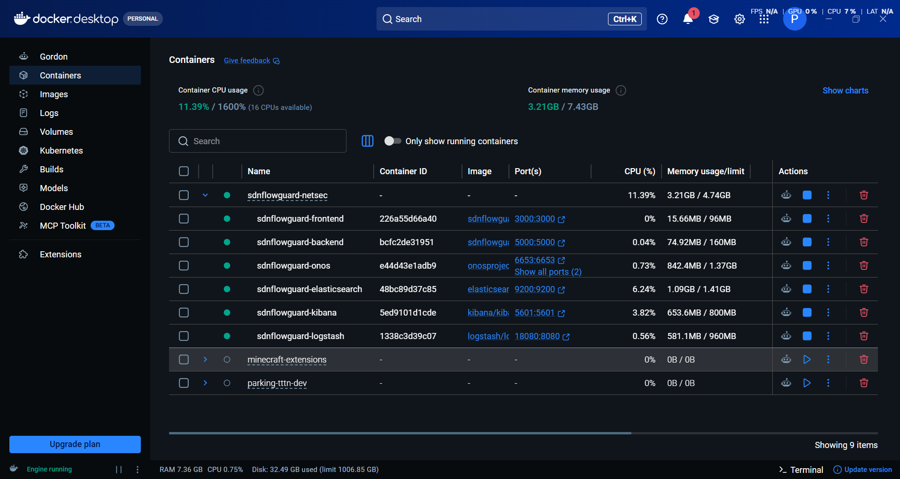<br>*Hình 4.1: Trạng thái 6 container microservices (backend, frontend, onos, elasticsearch, logstash, kibana) hoạt động ổn định trên Docker Desktop.* |
| **Hình 4.2:** Khởi động hệ thống và kiểm tra 7 cổng dịch vụ | 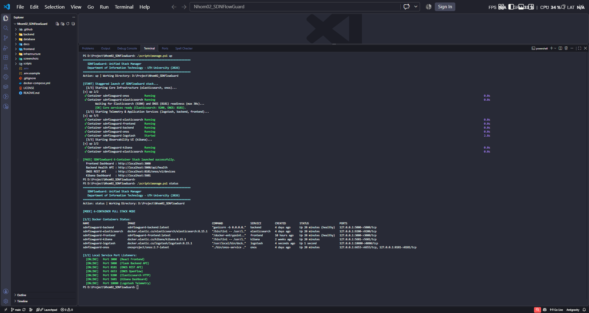<br>*Hình 4.2: Kết quả kiểm tra tính sẵn sàng và các cổng dịch vụ hạ tầng mạng qua lệnh manage.ps1 check (Overall Status: READY).* |
| **Hình 4.3:** Health Check hệ thống và quy mô tôpô mạng SDN | 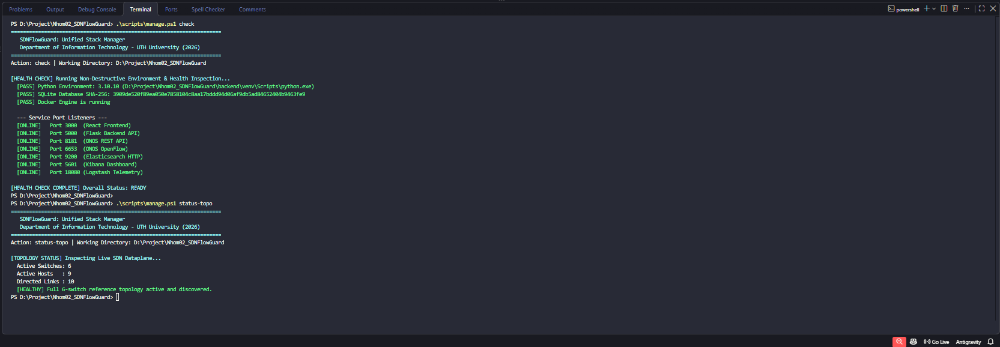<br>*Hình 4.3: Kết quả kiểm tra sức khỏe hệ thống và trạng thái kết nối mạng SDN (6 Switch, 9 Host, 10 Directed Links).* |
| **Hình 4.6:** Bảng điều khiển trung tâm (Dashboard) và thông lượng cổng switch RX/TX | 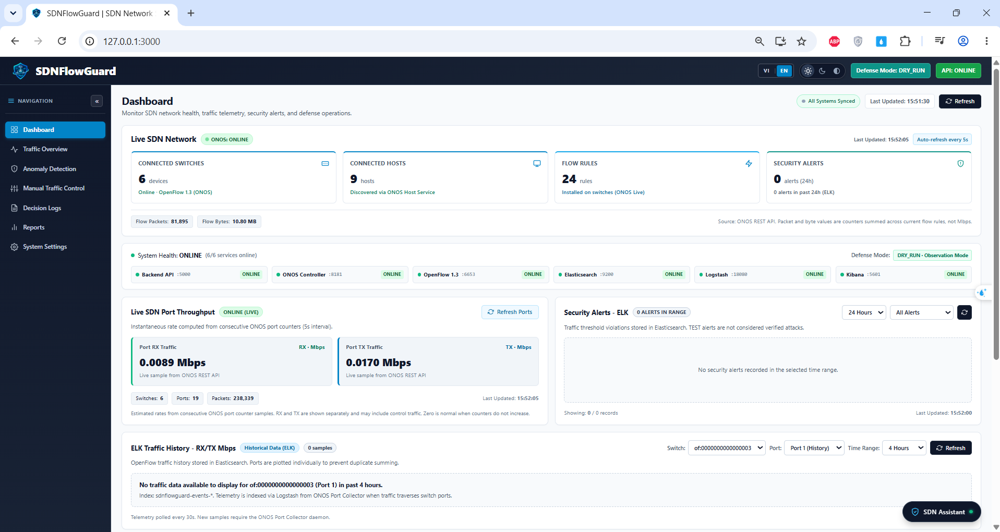<br>*Hình 4.6: Giao diện Trung tâm Giám sát (Dashboard) hiển thị thông lượng gói tin tức thời trên cổng switch và biểu đồ lưu lượng.* |

### B. SDN Network Monitoring

| Thành phần & Figure ID | Hình ảnh minh chứng thực nghiệm |
| :--- | :--- |
| **Hình 4.4:** Sơ đồ tôpô mạng SDN đa switch phân tầng trích xuất từ ONOS | 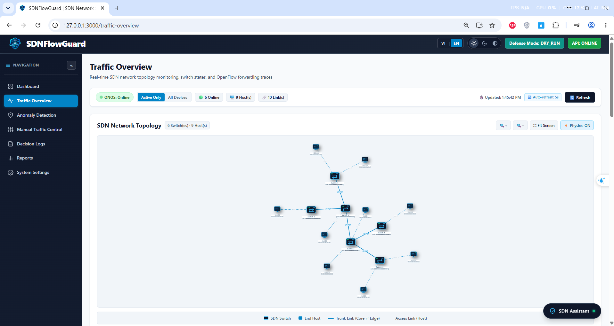<br>*Hình 4.4: Sơ đồ tôpô mạng SDN đa switch phân tầng trích xuất thời gian thực từ ONOS Controller (6 switch, 9 host, 10 directed links).* |
| **Hình 4.5:** Danh sách 24 luật luồng OpenFlow 1.3 và Match Criteria | 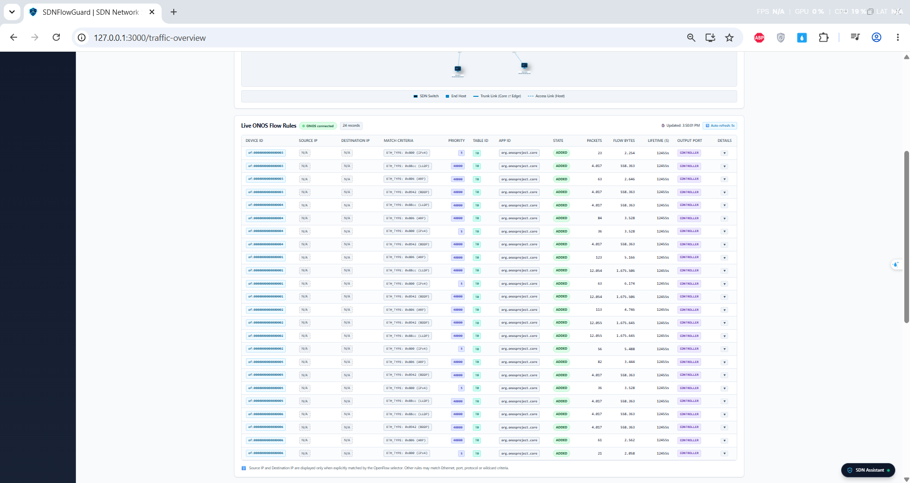<br>*Hình 4.5: Danh sách 24 luật luồng OpenFlow 1.3 và tiêu chí khớp gói (Match Criteria) được nạp trên các thiết bị chuyển mạch.* |

### C. Security Monitoring & Forensic Audit

| Thành phần & Figure ID | Hình ảnh minh chứng thực nghiệm |
| :--- | :--- |
| **Hình 4.7:** Khám phá dữ liệu Elasticsearch (Kibana Discover) với 145 bản ghi | 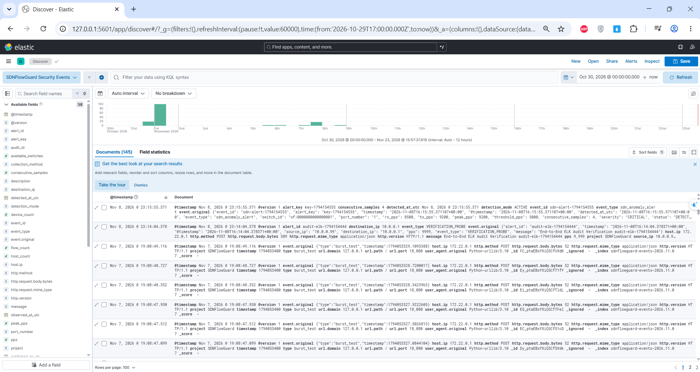<br>*Hình 4.7: Giao diện Kibana Discover truy vấn 145 bản ghi dữ liệu giám sát telemetry và cảnh báo an ninh trên cụm Elasticsearch.* |
| **Hình 4.8:** Phát hiện bất thường và đối chiếu bằng chứng nhận dạng host (Step 64) | 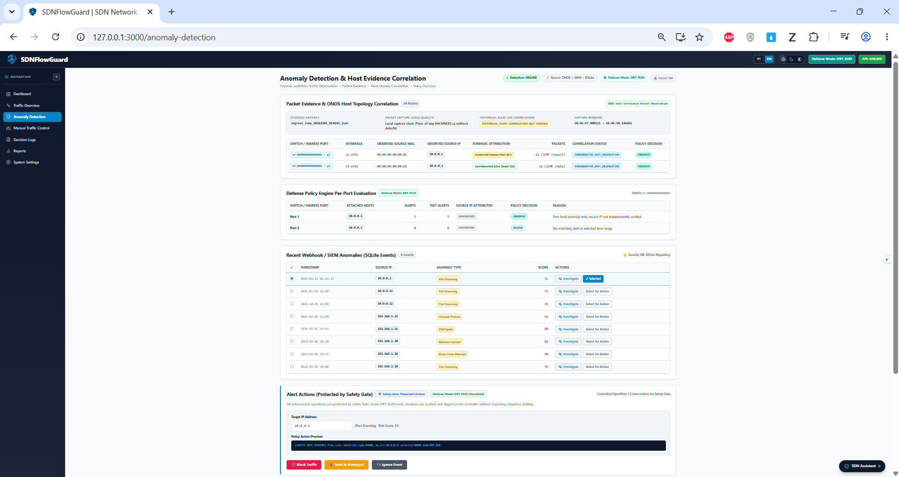<br>*Hình 4.8: Phân hệ phát hiện bất thường và đối chiếu bằng chứng gói tin với định danh host trên tôpô switch ONOS.* |
| **Hình 4.10:** Nhật ký kiểm toán quyết định phòng thủ (Decision Logs) | 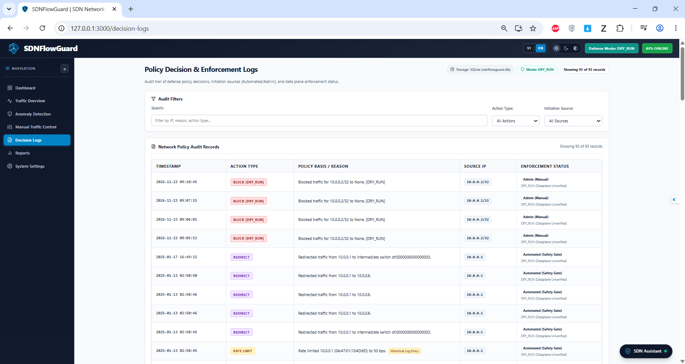<br>*Hình 4.10: Phân hệ nhật ký kiểm toán (Decision Logs) lưu vết 93 quyết định phòng thủ mạng (89 lịch sử + 4 quyết định 23/11/2026).* |
| **Hình 4.13:** Trung tâm Báo cáo An ninh & Kiểm toán SOC (Reports & Audit Center) | 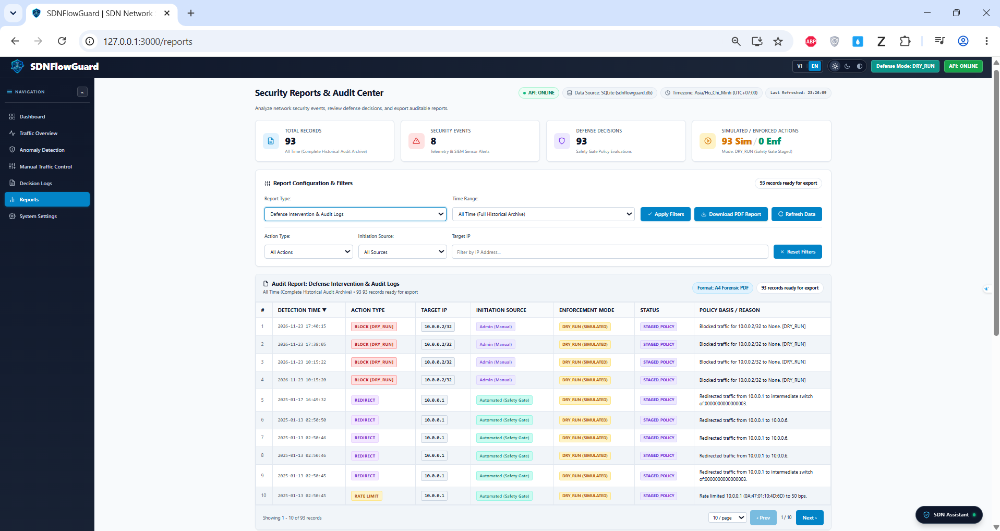<br>*Hình 4.13: Trung tâm Báo cáo An ninh & Kiểm toán SOC hiển thị 93 quyết định can thiệp (All Time) và 4 quyết định (Last 30 Days).* |
| **Hình 4.14:** Báo cáo sự kiện an ninh lịch sử (Security Events & Anomalies) | <br>*Hình 4.14: Báo cáo sự kiện an ninh lịch sử (Security Events & Anomalies) hiển thị 8 sự kiện mẫu giai đoạn 2024–2025.* |

### D. Network Defense & Safety Gate

| Thành phần & Figure ID | Hình ảnh minh chứng thực nghiệm |
| :--- | :--- |
| **Hình 4.9:** Đánh giá chính sách ngăn chặn địa chỉ IP 10.0.0.2/32 trong DRY_RUN | 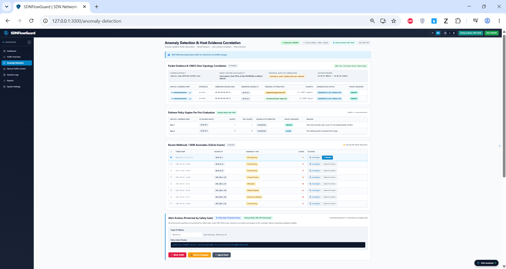<br>*Hình 4.9: Đánh giá chính sách ngăn chặn địa chỉ IP 10.0.0.2/32 qua Safety Gate trong chế độ mô phỏng DRY_RUN an toàn.* |
| **Hình 4.11:** Giao diện cấu hình chính sách can thiệp thủ công (Manual Control) | 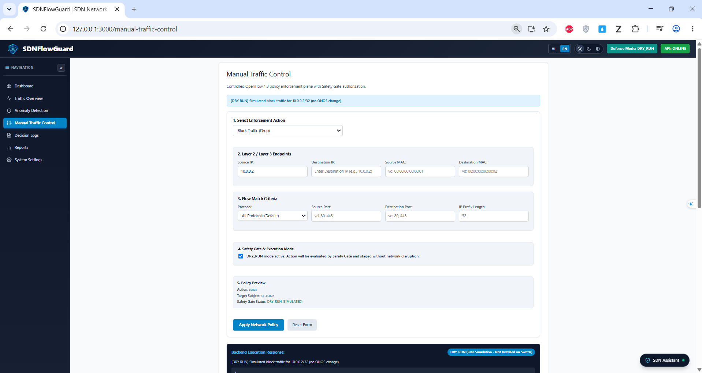<br>*Hình 4.11: Giao diện điều khiển luồng lưu lượng thủ công (Manual Traffic Control) với cảnh báo chế độ DRY_RUN và Safety Gate.* |
| **Hình 4.12:** Phản hồi kiểm toán từ Backend API và xem trước cấu trúc luật OpenFlow | 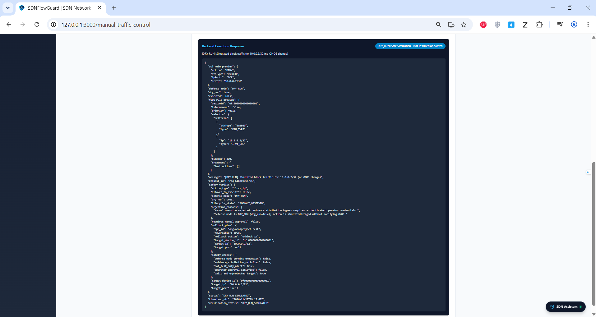<br>*Hình 4.12: Cấu trúc dữ liệu JSON phản hồi từ Backend API và bản xem trước luật OpenFlow 1.3 trước khi áp dụng.* |
| **Hình 4.16:** Giao diện cấu hình tham số hệ thống (System Settings) | 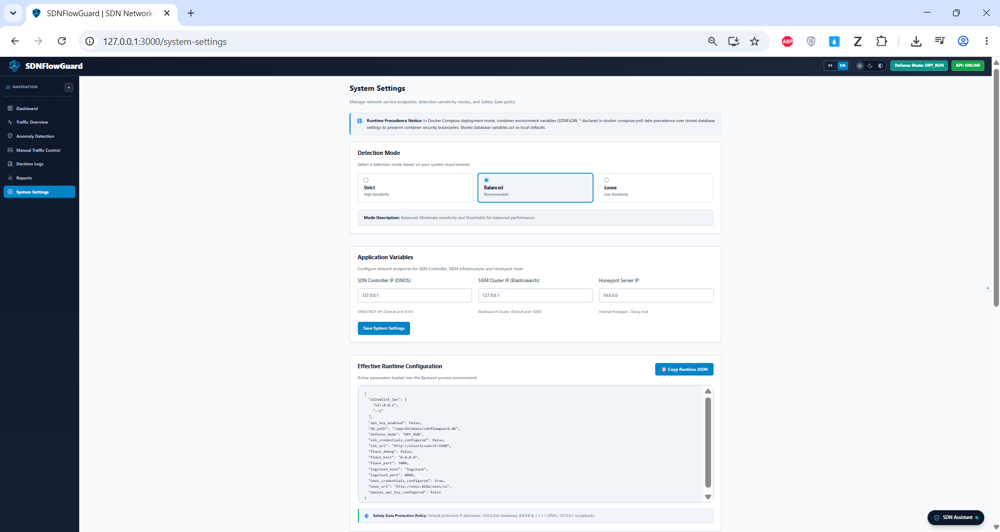<br>*Hình 4.16: Giao diện cấu hình hệ thống (System Settings) gồm chế độ phát hiện, địa chỉ IP và tham số Safety Gate.* |
| **Hình 4.22:** Kiểm định chính sách bảo vệ hạ tầng trọng yếu của Safety Gate | 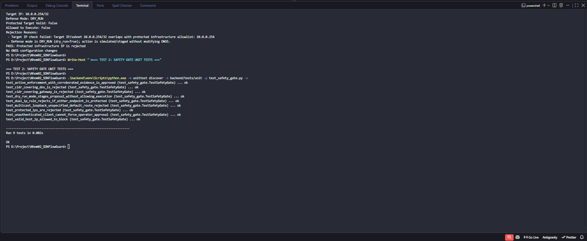<br>*Hình 4.22: Kiểm định chính sách bảo vệ hạ tầng trọng yếu của Safety Gate (9 bài kiểm thử bảo vệ Gateway/DNS/Loopback).* |
| **Hình 4.23:** Kiểm thử cơ chế hoàn tác chính sách phòng thủ (Rollback Rule) | 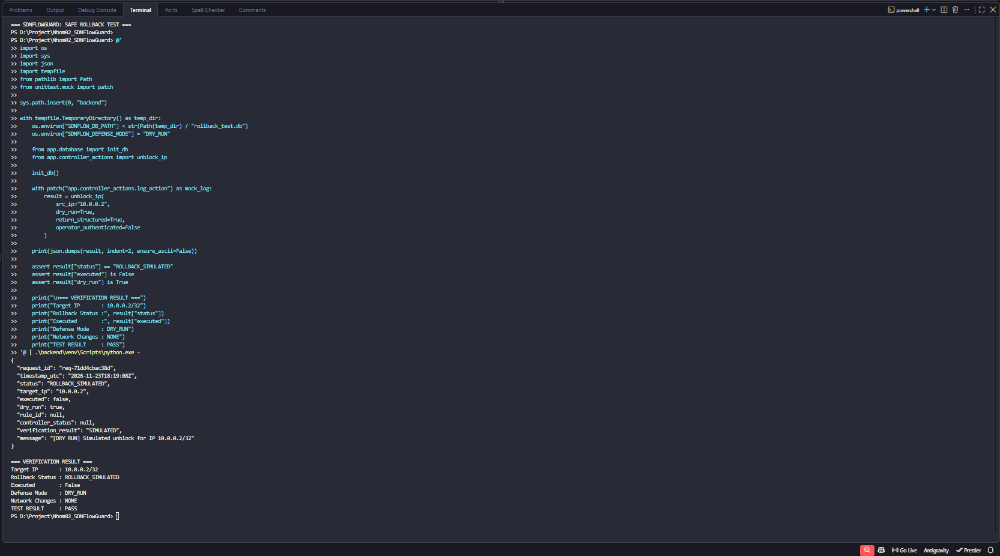<br>*Hình 4.23: Kiểm thử cơ chế hoàn tác chính sách phòng thủ (Rollback Defense Rule) trong chế độ mô phỏng DRY_RUN.* |

### E. Network Performance, Telemetry & Verification (10 Ảnh Mở Rộng)

<details>
<summary><strong>Xem chi tiết các hình ảnh thực nghiệm hiệu năng mạng và báo cáo PDF (Click để mở)</strong></summary>

| Thành phần & Figure ID | Hình ảnh minh chứng thực nghiệm |
| :--- | :--- |
| **Hình 4.15(a):** Báo cáo kiểm toán A4 PDF — Trang 1 | 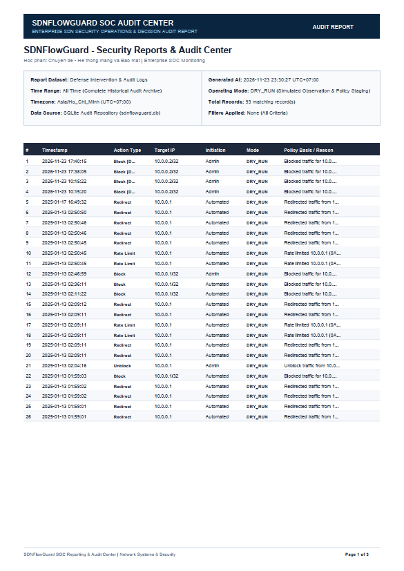<br>*Hình 4.15(a): Báo cáo kiểm toán A4 PDF — Trang 1: Tiêu đề báo cáo, KPI tổng quan và các bản ghi can thiệp đầu tiên.* |
| **Hình 4.15(b):** Báo cáo kiểm toán A4 PDF — Trang 2 | 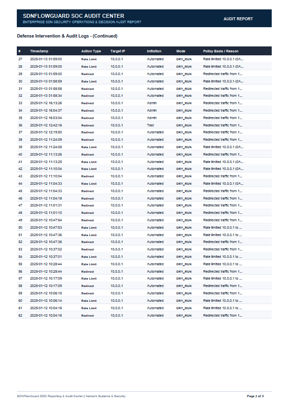<br>*Hình 4.15(b): Báo cáo kiểm toán A4 PDF — Trang 2: Chi tiết các bản ghi can thiệp phân dòng zebra shading.* |
| **Hình 4.15(c):** Báo cáo kiểm toán A4 PDF — Trang 3 | 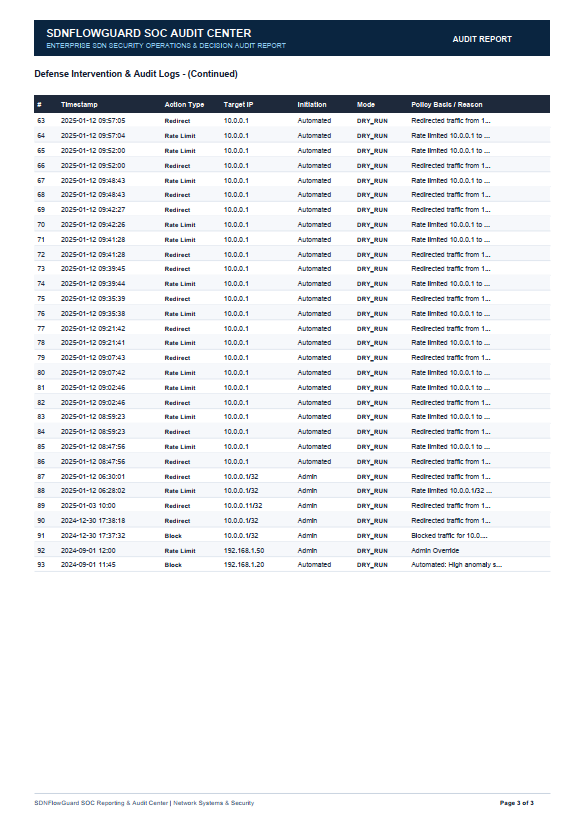<br>*Hình 4.15(c): Báo cáo kiểm toán A4 PDF — Trang 3: Các bản ghi can thiệp cuối cùng và chữ ký pháp chứng chân trang.* |
| **Hình 4.17:** Thực nghiệm kiểm chứng truyền thông cơ sở (Baseline ICMP) | 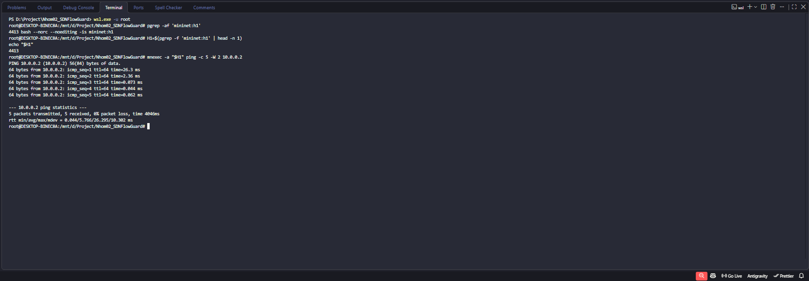<br>*Hình 4.17: Thực nghiệm kiểm chứng truyền thông cơ sở (Baseline ICMP) giữa Host h1 (10.0.0.1) và Host h2 (10.0.0.2).* |
| **Hình 4.18:** Kiểm thử kết nối toàn phần Full-Mesh ICMP giữa 9 host (72/72) | 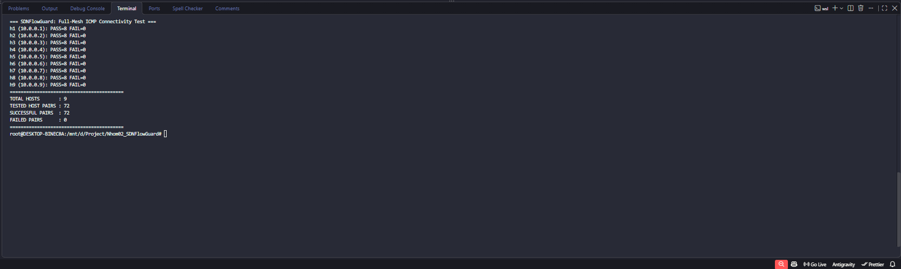<br>*Hình 4.18: Kết quả kiểm thử kết nối toàn phần Full-Mesh ICMP giữa 9 host (72/72 cặp có hướng thành công, 0% packet loss).* |
| **Hình 4.19:** Đo thông lượng TCP bằng iPerf từ Host h1 đến Host h9 | 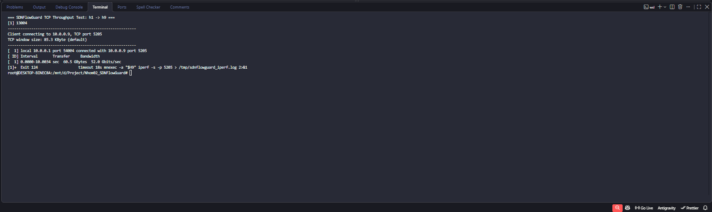<br>*Hình 4.19: Đo thông lượng TCP bằng iPerf từ Host h1 đến Host h9 trong môi trường mạng Mininet ảo hóa (~52 Gbit/s).* |
| **Hình 4.20:** Pipeline tiếp nhận telemetry từ ONOS qua Logstash vào Elasticsearch | 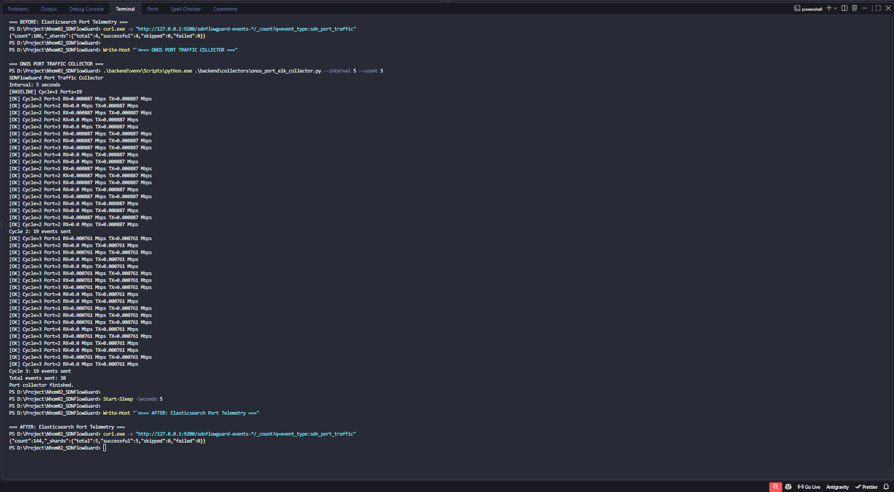<br>*Hình 4.20: Pipeline tiếp nhận telemetry từ ONOS qua Logstash vào Elasticsearch (38 sự kiện telemetry ghi nhận).* |
| **Hình 4.21:** Kết quả phân tích của bộ phát hiện bất thường PPS (PPS Detector) | 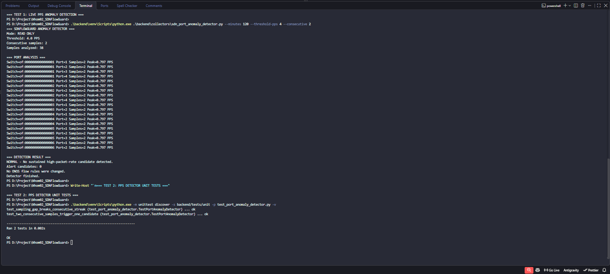<br>*Hình 4.21: Kết quả phân tích của bộ phát hiện bất thường PPS (PPS Detector) trong điều kiện lưu lượng bình thường và unit tests.* |
| **Hình 4.24:** Bảng tổng kết xác minh toàn vẹn hệ thống (System Verification) | 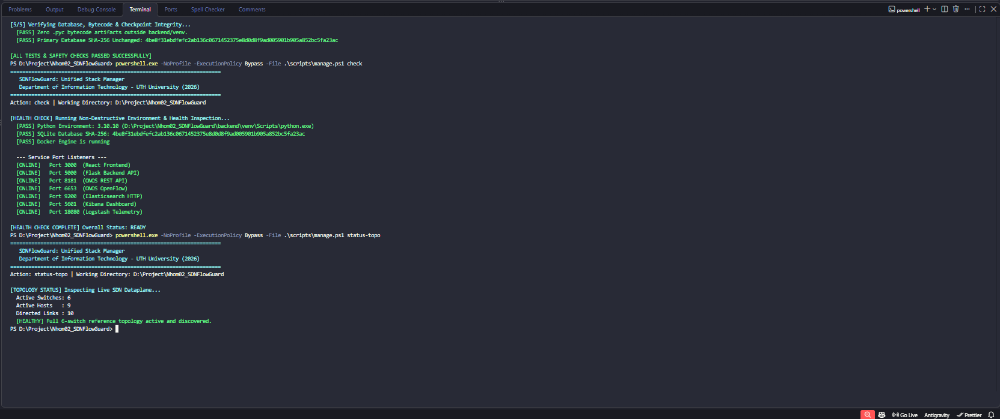<br>*Hình 4.24: Bảng tổng kết xác minh toàn vẹn hệ thống (System Verification Summary: 6 Switch, 9 Host, Overall Status READY).* |

</details>

### F. SDN Assistant Demonstration (3 Ảnh Trợ Lý Ảo)

| Thành phần & Figure ID | Hình ảnh minh chứng thực nghiệm |
| :--- | :--- |
| **Hình 4.25(a):** Giao diện Trợ lý vận hành an ninh SDN Assistant (Read-Only) | 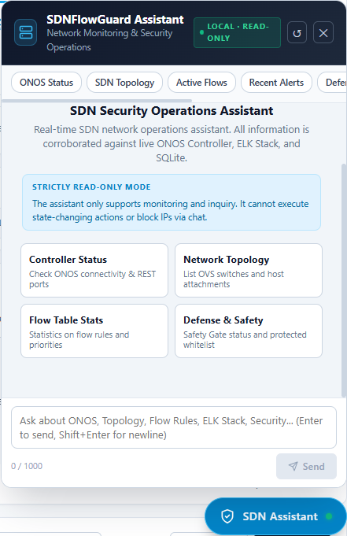<br>*Hình 4.25(a): Giao diện Trợ lý vận hành an ninh SDN Assistant hoạt động theo nguyên tắc Read-Only an toàn.* |
| **Hình 4.25(b):** Trợ lý SDN Assistant xử lý truy vấn trạng thái ONOS bằng tiếng Anh | 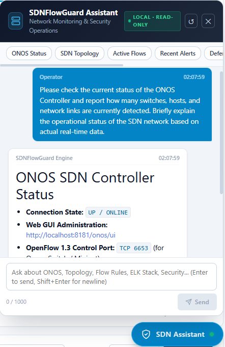<br>*Hình 4.25(b): Trợ lý SDN Assistant xử lý truy vấn trạng thái ONOS Controller bằng tiếng Anh.* |
| **Hình 4.25(c):** Phản hồi chi tiết của SDN Assistant về 6 switch từ ONOS REST API | 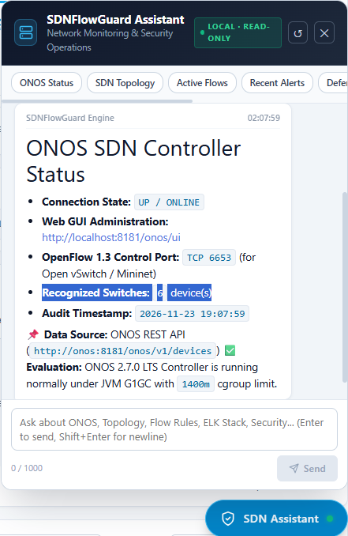<br>*Hình 4.25(c): Phản hồi chi tiết của SDN Assistant về 6 switch kết nối thời gian thực từ ONOS REST API.* |

---

## 15. Testing & Verification

SDNFlowGuard duy trì bộ kiểm thử tự động nghiêm ngặt gồm **107 bài kiểm thử** tích hợp và đơn vị:

```powershell
powershell -NoProfile -ExecutionPolicy Bypass -File .\scripts\test.ps1
```

### Kết quả kiểm định chất lượng:
1. **Python Syntax Verification:** 91 tệp Python biên dịch in-memory thành công, **0 lỗi cú pháp**, **0 tệp bytecode (.pyc)** tạo trên đĩa.
2. **CLI Self-Tests (4/4 PASS):** Monitor V2, Packet Evidence Analyzer, Step 64 Host Correlator, Defense Policy.
3. **Automated Test Suite (107 Tests PASS):**
   - Contracts: Elasticsearch & ONOS API schema verification.
   - Integration: Flask API routes, SQLite CRUD, Webhook ingestion, Chatbot composite query.
   - Safety: Anti-rogue rules, Gateway/DNS protection, operator authorization guardrails.
   - Unit: Risk scoring, SIEM normalization, topology parsing, reports date filtering.
   - End-to-End: Chu trình khép kín telemetry -> forensic correlation -> safety gate.
4. **Frontend Production Build:** Bản bundle React production tại `frontend/build/index.html` được kiểm chứng mới nhất.
5. **Database Immutability Check:** Giá trị băm SHA-256 của `database/sdnflowguard.db` không bị suy suyển sau khi chạy kiểm thử (`4be8f31ebdfefc2ab136c0671452375e8d0d8f9ad005901b905a852bc5fa23ac`).

---

## 16. Project Structure

```text
D:\Project\Nhom02_SDNFlowGuard\
├── backend/                       # Flask REST API, SDN controller actions, and tests
│   ├── app/                       # Application factory, routes, database adapter, chatbot
│   ├── collectors/                # Telemetry collector modules (Monitor V1 & V2)
│   ├── defense/                   # Step 63/64 forensic analysis and Safety Gate
│   ├── sdnflowguard/              # Clean Architecture domain models & policies
│   ├── tests/                     # Automated test suite (contracts, integration, safety, unit, e2e)
│   ├── run.py                     # Backend application entry point
│   ├── requirements.txt           # Python dependency specification
│   └── Dockerfile                 # Backend microservice container definition
├── frontend/                      # React 18 user interface SPA
│   ├── src/                       # Components, Pages, Theme, Localization (vi/en)
│   ├── public/                    # Assets, logos, index.html
│   ├── nginx.conf                 # Nginx reverse proxy configuration
│   ├── package.json               # Frontend dependencies and npm scripts
│   └── Dockerfile                 # Frontend microservice container definition
├── database/                      # SQLite database storage
│   ├── sdnflowguard.db            # Primary database file (Single Source of Truth)
│   └── sdnflowguard.db.bak        # Immutable backup snapshot
├── infrastructure/                # Supporting deployment configurations
│   ├── mininet/                   # Mininet topology scripts and setup files
│   └── logstash/                  # Logstash pipeline configuration
├── screenshots/                   # Verified laboratory screenshots and logo (29 proofs + 1 logo)
├── scripts/                       # Unified operational automation tools
│   ├── manage.ps1                 # Full lifecycle stack manager (check, up, down, status...)
│   ├── test.ps1                   # Master 5-stage test runner and integrity verifier
│   └── verify_readme_screenshots.py # Script kiểm tra toàn vẹn ảnh README tự động
├── docs/                          # Comprehensive technical and academic documentation
│   ├── academic/                  # Academic scope and requirements traceability
│   ├── architecture/              # System architecture and data flow diagrams
│   ├── audit/                     # Verification logs and security audits
│   ├── evidence/                  # Raw experimental data and evidence logs
│   ├── operations/                # Runbooks and evidence consistency matrices
│   ├── security/                  # Safety Gate specifications and threat models
│   └── testing/                   # Test plan, test cases, and test results
├── .github/workflows/             # Continuous Integration pipeline
│   └── sdn_flowguard_ci.yml       # GitHub Actions workflow (Python, Node, Docker validation)
├── docker-compose.yml             # Canonical 6-container Docker Compose configuration
├── .env.example                   # Environment variable template without secrets
├── .gitignore                     # Git ignore rules for clean repository
├── LICENSE                        # Open-source MIT License
└── README.md                      # Official engineering documentation (This file)
```

---

## 17. Troubleshooting Guide

| Triệu chứng lỗi | Nguyên nhân | Biện pháp xử lý |
| :--- | :--- | :--- |
| **`open //./pipe/docker_engine`** | Docker Desktop chưa khởi động hoàn tất. | Mở Docker Desktop, chờ trạng thái xanh lá (*Engine running*), sau đó chạy lại script. |
| **ONOS UI báo HTTP 403 Forbidden** | Truy cập sai URL gốc `http://127.0.0.1:8181/`. | **Bắt buộc nhập đầy đủ URL:** `http://127.0.0.1:8181/onos/ui` (tài khoản: `onos` / `rocks`). |
| **Cổng 6653 bị ngắt kết nối trình duyệt** | Cổng OpenFlow 1.3 là socket nhị phân TCP dành riêng cho switch. | Tuyệt đối không mở cổng `6653` bằng trình duyệt web. |
| **Logstash cổng 18080 hiển thị chữ `ok`** | Mở webhook endpoint qua phương thức GET. | Đây là phản hồi probe chuẩn của Elastic HTTP input. Để xem dữ liệu, hãy truy cập Kibana (`5601`). |
| **Chính sách PowerShell ExecutionPolicy** | Windows chặn thực thi file script `.ps1`. | Sử dụng cờ Bypass: `powershell.exe -NoProfile -ExecutionPolicy Bypass -File .\scripts\<script>.ps1`. |

---

## 18. Limitations & Research Boundaries

- **Môi trường thí nghiệm ảo hóa:** Băng thông đo được qua iPerf (~52 Gbps) phản ánh thông lượng bộ nhớ nội bộ của nhân Linux WSL2 giữa các container/process mạng Mininet, không phải là thông số của giao tiếp vật lý ngoài thực tế.
- **Ranh giới thực thi can thiệp mạng:** Hệ thống duy trì chế độ an toàn `DRY_RUN` để bảo vệ mạng lab, việc thực thi `ACTIVE_ENFORCEMENT` được thiết kế có kiểm soát và yêu cầu xác thực API key của quản trị viên.
- **Phân loại bản ghi Elasticsearch:** Tổng số 145 tài liệu trong Elasticsearch gồm 106 bản ghi đo thông lượng cổng định kỳ (`sdn_port_traffic`), 11 cảnh báo an ninh (`sdn_anomaly_alert`), 5 snapshot tôpô và 4 gói tin probe; không phải là 145 cuộc tấn công mạng riêng biệt.

---

## 19. References & License

Dự án được phân phối chính thức theo giấy phép nguồn mở **MIT License**. Chi tiết điều khoản bản quyền xem tại tệp [`LICENSE`](LICENSE).
