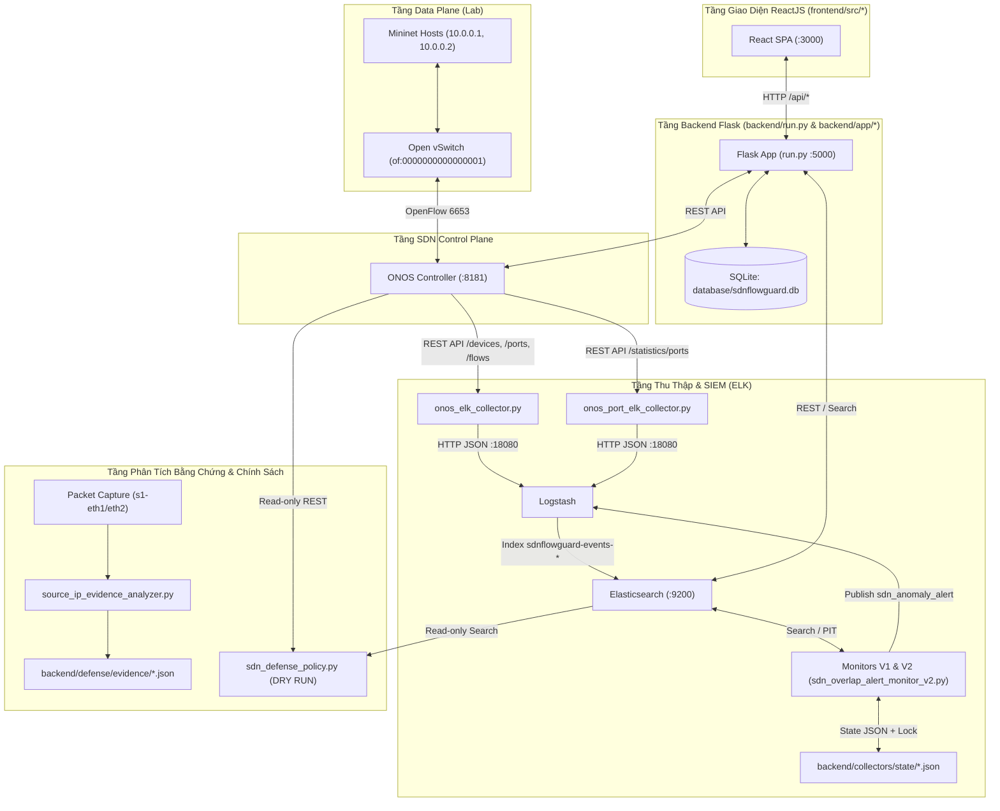

# Kiến Trúc Hiện Tại Của Hệ Thống SDNFlowGuard (Pre-Refactor Baseline)

## 1. Tổng Quan Kiến Trúc Trước Khi Refactor

Hệ thống **SDNFlowGuard** (được phát triển và mở rộng từ nền tảng `NetSecFlow`) là hệ thống giám sát lưu lượng mạng SDN tập trung và hỗ trợ phòng thủ tự động/bán tự động thông qua bộ điều khiển **ONOS**, **Mininet / Open vSwitch**, **ELK Stack (Elasticsearch, Logstash, Kibana)**, cơ sở dữ liệu **SQLite**, backend **Python Flask** (Python 3.10.10) và giao diện quản trị **ReactJS**.

Trước giai đoạn refactor theo Clean Architecture, hệ thống tồn tại dưới dạng kết hợp giữa:

1. **Khối Web Application nguyên bản (`backend/run.py`, `backend/app/*`, `frontend/src/*`)**:
   - Cung cấp REST API cho giao diện React, quản lý cấu hình trong SQLite (`database/sdnflowguard.db`), nhận cảnh báo qua `/webhook`, chấm điểm rủi ro theo nguồn sự kiện (`decision.py`) và gọi trực tiếp REST API của ONOS (`controller_actions.py`, `topology.py`).
2. **Khối Telemetry Collectors & Alert Monitors mở rộng (`backend/collectors/*`)**:
   - Các tiến trình CLI độc lập thu thập snapshot topology (`onos_elk_collector.py`) và thống kê cổng OpenFlow (`onos_port_elk_collector.py`) từ ONOS đẩy qua Logstash (`127.0.0.1:18080`) vào Elasticsearch (`sdnflowguard-events-*`).
   - Các bộ phát hiện và giám sát cảnh báo vượt ngưỡng PPS theo cổng: `sdn_port_anomaly_detector.py`, `sdn_alert_publisher.py`, `sdn_auto_alert_monitor.py`, `sdn_reliable_alert_monitor.py` (V1) và `sdn_overlap_alert_monitor_v2.py` (V2 — hỗ trợ dữ liệu đến muộn với Point-in-Time và sliding window).
3. **Khối Defense Policy & Evidence Analysis (`backend/defense/*`)**:
   - `sdn_defense_policy.py`: Đánh giá chính sách phòng thủ ở chế độ `DRY_RUN` (chỉ đọc), ngăn chặn việc quy kết host gắn trên cổng là kẻ tấn công khi chỉ có thống kê PPS cấp cổng hoặc cảnh báo `test_only=True`.
   - `source_ip_evidence_analyzer.py` (hoàn thành ở Bước 63): Phân tích gói tin bắt tại cổng switch (`s1-eth1`, `s1-eth2`) để trích xuất bằng chứng quan sát `MAC` + `IP` nguồn/đích của gói ICMP, đồng thời ghi nhận giới hạn thiếu ngày/múi giờ (`capture_clock_has_date=False`, `capture_clock_has_timezone=False`).

---

## 2. Sơ Đồ Luồng Dữ Liệu & Phụ Thuộc Hiện Tại

---

## 3. Phân Bố Chức Năng Hiện Tại Theo Thành Phần

| Thành phần | Đường dẫn | Vai trò hiện tại | Trạng thái trước Refactor |
| :--- | :--- | :--- | :--- |
| **Flask Entrypoint** | `backend/run.py` | Khởi tạo Flask, đăng ký 24 routes, chứa trực tiếp logic truy vấn ONOS và Elasticsearch cho các API `/api/live-flows`, `/api/live-port-stats`, `/api/elk/*` | Hoạt động, nhưng trộn lẫn HTTP controller với logic truy vấn hạ tầng và chứa mật khẩu ELK hardcode |
| **Database Module** | `backend/app/database.py` | Truy cập trực tiếp SQLite (`settings`, `flows`, `events`, `actions`) | Hoạt động, dùng câu lệnh tham số hóa cơ bản, nhưng thiếu quản lý schema version và audit mở rộng |
| **SDN Controller Actions** | `backend/app/controller_actions.py` | Gọi ONOS `/acl/rules`, `/intents`, `/meters`, `/flows` | Hoạt động một phần; đọc IP ONOS lúc import module, không có timeout ở nhiều lệnh `requests`, dùng đường dẫn cũ `C:\netsecflow\backend\app\`, thiếu xác minh rule sau thực thi |
| **Webhook & Risk Engine** | `backend/app/reception.py`, `backend/app/decision.py` | Nhận sự kiện `/webhook`, tính điểm rủi ro tích lũy trong bảng `settings` và tự động gọi chặn/redirect/rate-limit | Tiềm ẩn rủi ro cao: gọi `init_db()` ngay khi import, không xác thực webhook, không kiểm tra `test_only`, tự động gọi lệnh thay đổi mạng không qua cổng an toàn |
| **Topology & Logging** | `backend/app/topology.py`, `backend/app/app_logging.py` | Lấy thiết bị/liên kết/host và lưu flow từ ONOS vào SQLite | Đọc `ONOS_CONTROLLER_IP` một lần duy nhất lúc import module (`import-time side effect`) |
| **Report & Chatbot** | `backend/app/report.py`, `backend/app/chatbot.py` | Xuất báo cáo tháng JSON/PDF (`pdfkit`) và trợ lý ảo OpenAI | `report.py` phụ thuộc binary `wkhtmltopdf` bên ngoài; `chatbot.py` khởi tạo client Elasticsearch với IP cố định `192.168.102.1` khi import |
| **Collectors & Monitors** | `backend/collectors/*.py` | Thu thập số liệu cổng ONOS và phát hiện cảnh báo PPS cao (V1, V2) | Thiết kế độc lập tốt, có kiểm tra Python 3.10.10, file lock `msvcrt` và ghi checkpoint nguyên tử (`.tmp` + `os.replace`) |
| **Defense & Evidence** | `backend/defense/*.py` | Đánh giá chính sách phòng thủ DRY RUN và phân tích gói tin ICMP Bước 63 | Đạt chuẩn an toàn DRY RUN; cần hoàn thiện **Bước 64** (đối chiếu bằng chứng packet capture với topology ONOS) và kết nối với tầng Application/API |
| **React Frontend** | `frontend/src/*` | Giao diện 7 trang: Dashboard, Traffic Overview, Anomaly Detection, Decision Logs, Manual Traffic Control, Reports, System Settings | Build thành công, đã cập nhật nhận diện SDNFlowGuard; cần đồng bộ URL API, sửa `activeClassName` của React Router v6, bỏ nút Logout giả và bổ sung trạng thái Dry Run / Verification / Evidence Correlation |

