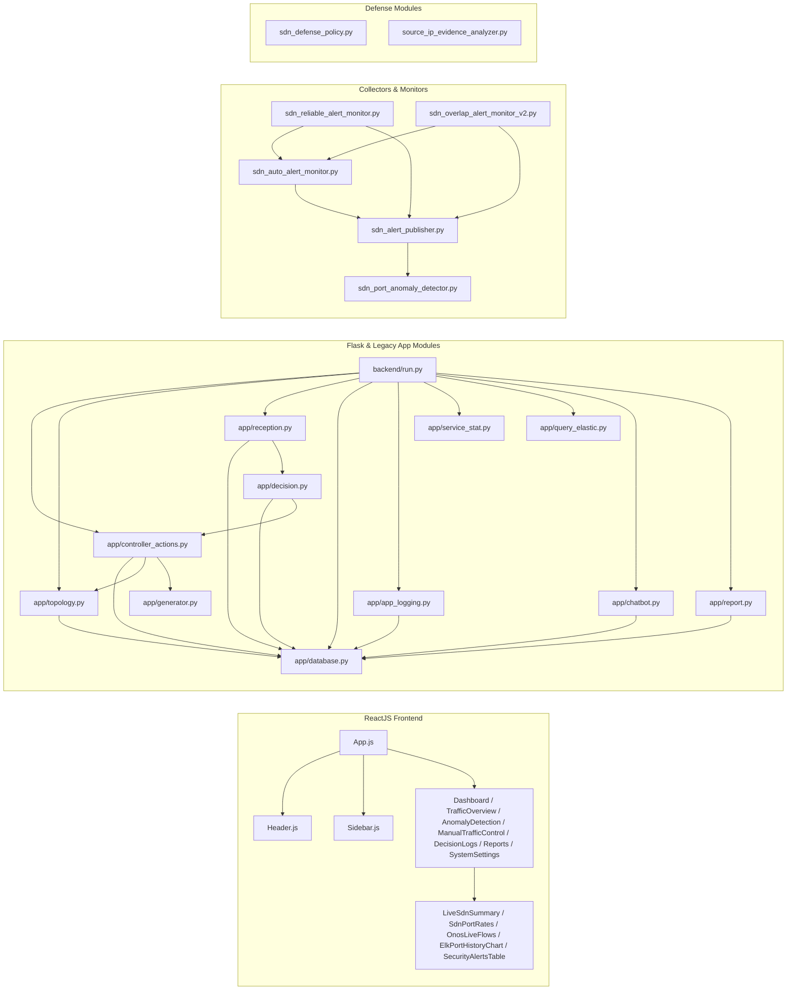

# Kiểm Toán Phụ Thuộc (Dependency Audit) — SDNFlowGuard

## 1. Đồ Thị Phụ Thuộc Giữa Các Module Trước Khi Refactor

---

## 2. Phân Tích Chi Tiết Các Vấn Đề Phụ Thuộc

### 2.1. Import Side Effects (Tác dụng phụ ngay khi `import`)

Đây là lỗi kiến trúc nghiêm trọng nhất trong các module `backend/app/*.py`:

1. **`backend/app/reception.py` (Dòng 6–9):**
   - Khởi tạo một thực thể `app = Flask(__name__)` thứ hai và gọi ngay `init_db()` ở mức module khi `run.py` thực hiện `from reception import webhook`.
   - Hệ quả: Mọi lệnh chỉ `import run` để kiểm thử đều tự động mở kết nối ghi vào `database/sdnflowguard.db`.
2. **`backend/app/controller_actions.py` (Dòng 10–11):**
   - Gọi `ONOS_CONTROLLER_IP = get_setting_value("SDN Controller IP")` ngay khi import.
   - Hệ quả: Nếu người dùng thay đổi IP của ONOS trên trang **System Settings** (`/api/save-settings`), biến `ONOS_API_BASE` trong `controller_actions.py` vẫn giữ giá trị cũ cho tới khi khởi động lại tiến trình Flask.
3. **`backend/app/topology.py` (Dòng 7–8) & `backend/app/app_logging.py` (Dòng 4–5):**
   - Tương tự `controller_actions.py`, cả hai module đều đọc `ONOS_CONTROLLER_IP = get_setting_value("SDN Controller IP")` một lần duy nhất ở thời điểm import.
4. **`backend/app/chatbot.py` (Dòng 14–18):**
   - Khởi tạo `elk_client = Elasticsearch("http://192.168.102.1:9200", ...)` ngay khi import module.

### 2.2. Thao Tác `sys.path` & Phụ Thuộc Thư Mục Làm Việc Hiện Tại (CWD Coupling)

1. **`backend/run.py` (Dòng 6 & 20):**
   - Dùng đường dẫn tương đối `sys.path.insert(1, 'app/')` và `PDF_DIRECTORY = os.path.abspath("generated_reports")`.
   - Nếu chạy `python backend/run.py` từ thư mục gốc `D:\Project\Nhom02_SDNFlowGuard` thay vì đứng trong `D:\Project\Nhom02_SDNFlowGuard\backend`, lệnh `from controller_actions import ...` sẽ lỗi `ModuleNotFoundError`!
2. **`backend/app/controller_actions.py` (Dòng 14, 411, 575):**
   - Hardcode `CONFIG_DIRECTORY = 'C:\\netsecflow\\backend\\app\\'` và ghi trực tiếp file `intent_*.json` ra thư mục làm việc hiện tại (`with open(filename, 'w')`).

### 2.3. Business Logic Trộn Lẫn Trong HTTP Controller & Infrastructure Coupling

1. **`backend/run.py`:**
   - Các hàm `get_live_flows()`, `get_live_port_stats()`, `elk_port_traffic_history()`, `elk_security_alerts()` chứa trực tiếp câu truy vấn DSL của Elasticsearch, URL `http://127.0.0.1:9200/...` và logic biến đổi dữ liệu ONOS ngay trong tầng route handler.
2. **`backend/app/decision.py`:**
   - Trộn lẫn thuật toán tính điểm rủi ro (`CONFIDENCE_RATES`, `DETECTION_MODES`), lưu trữ trạng thái điểm vào bảng `settings` của SQLite (`save_settings({f"{sourceip} marks": ...})`), và gọi trực tiếp hàm thực thi mạng (`block_ip`, `redirect_traffic_full`, `rate_limit_for_host`, `redirect_to_intermediate_ovs`).
   - Không có lớp trừu tượng (interface/gateway), khiến việc kiểm thử đơn vị (unit test) cho `process_event()` nếu không mock toàn bộ SQLite và ONOS sẽ trực tiếp ghi vào DB và gọi mạng.

### 2.4. Sự Cô Lập Giữa Nhánh Mới (Step 42–63) và Nhánh Web Gốc

- Các module mới chất lượng cao trong `backend/defense/sdn_defense_policy.py` và `backend/defense/source_ip_evidence_analyzer.py` hoạt động độc lập qua CLI nhưng chưa được kết nối thành Application Use Cases phục vụ cho Flask API và giao diện React.
- Ngược lại, các API điều khiển trong `backend/run.py` (`/api/block`, `/api/allow`, `/api/rate-limit`, `/api/redirect`, `/api/unblock`) và `/webhook` vẫn gọi thẳng vào `controller_actions.py` cũ mà chưa đi qua **Safety Gate** (`SDNFLOW_DEFENSE_MODE=DRY_RUN`, bảo vệ cảnh báo `test_only`, bảo vệ allowlist/controller IP, xác minh bằng chứng nguồn Bước 63–64).

---

## 3. Kiểm Toán Phụ Thuộc Thư Viện (Packages)

### 3.1. Backend (`backend/requirements.txt` trên Python 3.10.10)
- `Flask==3.0.3`, `Flask-Cors==4.0.1`, `Werkzeug==3.0.4`
- `requests==2.32.3`, `urllib3==2.2.2`, `httpx==0.28.1`, `aiohttp==3.11.11`
- `elasticsearch==8.15.1`, `elastic-transport==8.15.1`
- `pydantic==2.10.4`
- `openai==0.28.0`
- **Lưu ý quan trọng:** `backend/app/report.py` thực hiện `import pdfkit`, thư viện này có mặt trong `backend/venv/Lib/site-packages` nhưng không được liệt kê trong `requirements.txt` và yêu cầu phần mềm hệ thống `wkhtmltopdf` khi xuất PDF. Cần bổ sung cơ chế fallback xuất PDF thuần Python không phụ thuộc binary ngoài khi `wkhtmltopdf` không có sẵn.

### 3.2. Frontend (`frontend/package.json`)
- `react@^18.3.1`, `react-dom@^18.3.1`, `react-router-dom@^6.26.1`, `react-scripts@5.0.1`
- `axios@^1.7.5`, `chart.js@^4.4.7`, `react-chartjs-2@^5.3.0`, `vis-network@^9.1.9`, `bootstrap@^5.3.3`
- **Lưu ý quan trọng:** Trong `frontend/src/components/Sidebar.js`, component `NavLink` của `react-router-dom` v6 đang dùng prop cũ của v5 là `activeClassName="active"`, không còn tác dụng trong v6 và gây cảnh báo DOM.

