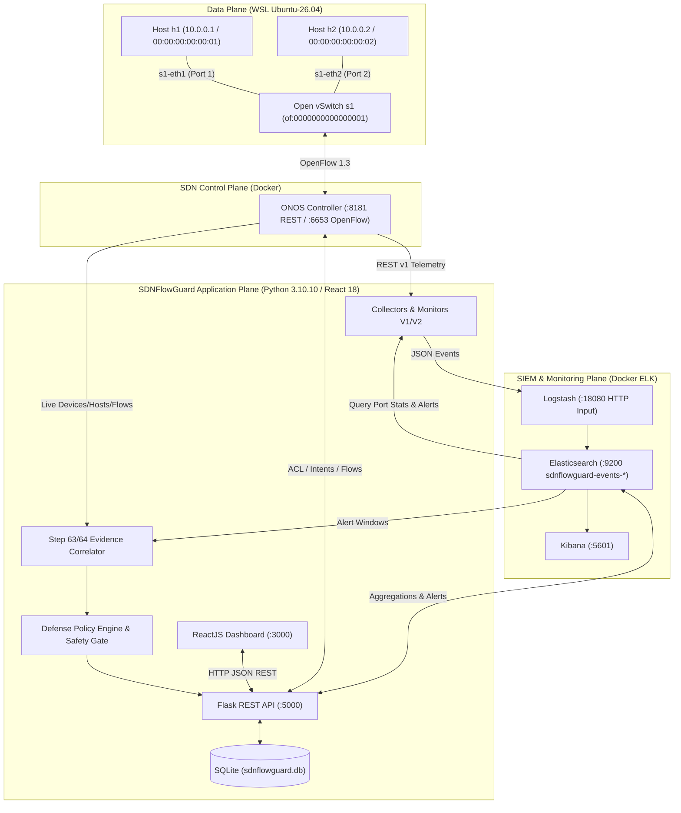

# BÁO CÁO TỔNG KẾT ĐỒ ÁN CHUYÊN ĐỀ
## ĐỀ TÀI: NGHIÊN CỨU VÀ TRIỂN KHAI PHÒNG THỦ MẠNG TỰ ĐỘNG QUA SDN TÍCH HỢP GIÁM SÁT BẰNG ELK STACK

- **Môn học:** Chuyên đề – Hệ thống mạng và bảo mật
- **Nhóm thực hiện:** Nhóm 02 — Dự án `Nhom02_SDNFlowGuard`
- **Workspace chính:** `D:\Project\Nhom02_SDNFlowGuard`
- **Gói bàn giao chuẩn hóa:** `D:\Project\SDNFlowGuard_Final_Submission`
- **Tài liệu đề cương cơ sở:** `Nhom02_PhanPhatDat_Tong_quan_de_tai.docx` (Ghi chú: File `.docx` gốc không nằm trực tiếp trong cây thư mục workspace; toàn bộ mục tiêu học thuật cốt lõi được đối chiếu đầy đủ và minh bạch theo đặc tả đề tài).
- **Công nghệ cốt lõi:** Windows PowerShell, Python `3.10.10` (`backend\venv\Scripts\python.exe`), Flask REST API, ReactJS 18, SQLite 3, ONOS SDN Controller (`2.7.0`), OpenFlow `1.3`, Mininet + Open vSwitch (`3.7.1` trên WSL `Ubuntu-26.04`), Elasticsearch – Logstash – Kibana (`7.17.18`), Docker Compose.

---

## 1. GIỚI THIỆU ĐỀ TÀI
Sự phát triển nhanh chóng của hạ tầng mạng doanh nghiệp và trung tâm dữ liệu đặt ra yêu cầu bức thiết về khả năng **giám sát an ninh mạng tập trung** kết hợp với **phản ứng phòng thủ tự động có kiểm soát**. Đề tài **"Nghiên cứu và triển khai phòng thủ mạng tự động qua SDN tích hợp giám sát bằng ELK Stack"** xây dựng hệ thống **SDNFlowGuard** — một nền tảng tích hợp giữa Mạng khả lập trình (Software-Defined Networking – SDN) sử dụng bộ điều khiển **ONOS** và hệ thống thu thập, phân tích sự kiện bảo mật tập trung **ELK Stack** (Elasticsearch, Logstash, Kibana), đi kèm bảng điều khiển quản trị **ReactJS/Flask** và động cơ quyết định phòng thủ đa tầng (**Defense Policy Engine & Safety Gate**).

---

## 2. ĐẶT VẤN ĐỀ VÀ ĐỘNG LỰC NGHIÊN CỨU
Trong mạng truyền thống, mặt phẳng điều khiển (Control Plane) và mặt phẳng dữ liệu (Data Plane) gắn chặt trên từng thiết bị định tuyến/chuyển mạch độc lập, dẫn đến 3 hạn chế lớn khi xử lý sự cố an ninh mạng:
1. **Thiếu tầm nhìn toàn cục theo thời gian thực:** Quản trị viên khó tổng hợp tức thời trạng thái topology, bảng luồng (flow tables) và thống kê cổng (port counters) trên một giao diện thống nhất.
2. **Độ trễ phản ứng cao:** Khi phát hiện lưu lượng bất thường (như ngập lụt gói tin ICMP/UDP/SYN flood), việc cấu hình ACL thủ công trên từng thiết bị tốn nhiều thời gian.
3. **Nguy cơ chặn nhầm (False Positive Blocking) trong phòng thủ tự động:** Nhiều hệ thống tự động hóa ngây thơ chặn ngay địa chỉ IP của host gắn vào cổng switch khi thấy tốc độ gói tin (`rx_pps`/`tx_pps`) vượt ngưỡng. Tuy nhiên, trong thực tế:
   - Thống kê cổng (`port counters`) chỉ đo tổng lưu lượng đi qua cổng vật lý/ảo, không cho biết địa chỉ IP nguồn thực sự trong từng gói tin.
   - Host gắn trên cổng (`Attached Host`) có thể là nạn nhân nhận lưu lượng phản hồi, hoặc có nhiều host cùng nối qua một cổng chuyển mạch, hoặc lưu lượng tăng cao là kết quả của bài kiểm thử (`test_only: true`).
   - Do đó, nguyên lý cốt lõi của đồ án là: **`Attached Host != Verified Attacker`** (Host gắn trên cổng có cảnh báo không đồng nghĩa với kẻ tấn công đã được xác minh).

---

## 3. MỤC TIÊU VÀ PHẠM VI ĐỀ TÀI

### 3.1. Mục tiêu học thuật và kỹ thuật
1. Thiết lập mô hình mạng SDN thực nghiệm với **ONOS Controller**, **Open vSwitch (OVS)** và **Mininet** (`of:0000000000000001`, `h1 = 10.0.0.1`, `h2 = 10.0.0.2`).
2. Thu thập số liệu mạng SDN (topology, hosts, flows, port statistics) đẩy qua **Logstash HTTP input (`18080`)** vào **Elasticsearch (`9200`)** và hiển thị trên **Kibana (`5601`)** cùng **React Dashboard (`3000`)**.
3. Phát hiện bất thường lưu lượng cổng theo chuỗi thời gian liên tiếp (`SUSTAINED_HIGH_PACKET_RATE`) bằng **Reliable Monitor V1** và **Overlap Alert Monitor V2** (xử lý dữ liệu đến trễ, lưu checkpoint bền vững, sinh khóa chống trùng lặp SHA-256 `alert_key`).
4. Thiết kế cơ chế **Xác minh bằng chứng nguồn 2 giai đoạn (Step 63 & Step 64)** kết hợp phân tích gói tin bắt tại cổng vào (`tcpdump -nne`) với dữ liệu topology trực tiếp từ ONOS (`LIVE_ONOS`).
5. Xây dựng **Defense Policy Engine** và **Safety Gate** mặc định ở chế độ an toàn `DRY_RUN`, chặn tuyệt đối việc khóa nhầm IP hạ tầng (`127.0.0.1`, Controller, ELK, multicast, broadcast) hoặc cảnh báo thử nghiệm (`test_only: true`), hỗ trợ đầy đủ cơ chế **Rollback / Unblock** và lưu vết kiểm toán SQLite.

### 3.2. Phạm vi đề tài và phân loại mức độ xác minh
Hệ thống phân biệt minh bạch hai phạm vi:
- **`VERIFIED_LAB_INTEGRATION` (Đã xác minh trực tiếp trên Lab thực tế):** Toàn bộ luồng Mininet/OVS ↔ ONOS ↔ Collectors ↔ Logstash ↔ Elasticsearch ↔ Kibana ↔ Flask API ↔ SQLite ↔ React UI ↔ Step 63/64 Evidence Correlation ↔ Safety Gate & Rollback.
- **`FIXTURE_SIMULATION` (Mô phỏng chuẩn hóa theo mẫu):** Bộ chuẩn hóa nhật ký đa nguồn SIEM cho Firewall Syslog và Windows Server Event Log (`/api/siem/evaluate-fixtures`, `/api/siem/normalize`), được kiểm thử tự động để chứng minh khả năng mở rộng SIEM mà không thổi phồng thành hạ tầng Firewall/Active Directory vật lý.

---

## 4. CƠ SỞ LÝ THUYẾT VỀ SDN, OPENFLOW, ONOS, MININET, OVS VÀ ELK STACK
- **Software-Defined Networking (SDN):** Kiến trúc mạng tách rời mặt phẳng điều khiển tập trung (ONOS) khỏi mặt phẳng chuyển tiếp gói tin (Open vSwitch).
- **Giao thức OpenFlow 1.3:** Cho phép bộ điều khiển ONOS truy vấn thống kê cổng (`OFPMP_PORT_STATS`), thống kê luồng (`OFPMP_FLOW`) và cài đặt các luật xử lý gói tin (`OFPFC_ADD`, `OFPFC_DELETE`) dựa trên trường khớp (`selector`: `ETH_TYPE`, `IPV4_SRC`, `IPV4_DST`, `IP_PROTO`) và hành động (`treatment`: `OUTPUT`, `DROP`/`NOACTION`).
- **ONOS SDN Controller:** Cung cấp REST API v1 (`/onos/v1/devices`, `/onos/v1/hosts`, `/onos/v1/flows`, `/onos/v1/statistics/ports`, `/onos/v1/acl/rules`, `/onos/v1/intents`) để giám sát và lập trình mạng.
- **Mininet & Open vSwitch (OVS):** Mô phỏng mạng SDN với các namespace mạng cô lập cho từng host (`h1`, `h2`) nối vào switch ảo `s1` (`of:0000000000000001`) chạy OpenFlow 1.3.
- **ELK Stack (Elasticsearch – Logstash – Kibana):**
  - **Logstash:** Nhận sự kiện JSON qua cổng HTTP `18080`, chuẩn hóa trường `@timestamp`, `event_type`, `source_component`, `test_only`.
  - **Elasticsearch:** Lưu trữ chỉ mục thời gian thực `sdnflowguard-events-*` (`sdnflowguard-events-2026.10.31`, `sdnflowguard-events-2026.11.05`) phục vụ truy vấn tổng hợp (aggregations) và tìm kiếm cảnh báo.
  - **Kibana:** Trực quan hóa biểu đồ lưu lượng và nhật ký sự kiện bảo mật.

---

## 5. PHÂN TÍCH YÊU CẦU CHỨC NĂNG VÀ PHI CHỨC NĂNG

### 5.1. Yêu cầu chức năng
1. Quan sát trực tiếp trạng thái switch, host, liên kết và danh sách flow rules từ ONOS.
2. Thu thập định kỳ thống kê cổng (`rx_packets`, `tx_packets`, `rx_pps`, `tx_pps`, `rx_bps`, `tx_bps`) và đẩy vào ELK.
3. Phát hiện chuỗi mẫu vượt ngưỡng liên tiếp (`consecutive_hits >= 2`) và phát hành cảnh báo chống trùng lặp.
4. Phân tích bằng chứng gói tin L2/L3 (`Step 63`) và đối chiếu với bảng host/port/flow của ONOS (`Step 64`).
5. Đánh giá chính sách phòng thủ (`ALLOW`, `OBSERVE`, `RATE_LIMIT`, `REDIRECT`, `PROPOSE_BLOCK`, `TEMP_BLOCK`, `UNBLOCK`) qua Safety Gate.
6. Cung cấp giao diện ReactJS gồm 7 phân trang: `Dashboard`, `Traffic Overview`, `Anomaly Detection`, `Manual Traffic Control`, `Decision Logs`, `Reports`, `System Settings`.
7. Xuất báo cáo tổng hợp định dạng JSON và PDF (`%PDF-1.4`).

### 5.2. Yêu cầu phi chức năng
- **An toàn mặc định (Fail-Safe by Default):** Mặc định `SDNFLOW_DEFENSE_MODE=DRY_RUN`; khi ONOS hoặc ELK tạm ngưng, API không sinh lỗi `500` hoặc treo kết nối mà trả về trạng thái suy giảm an toàn (`DEGRADED` / `OBSERVE`).
- **Bảo mật cấu hình:** Không lưu mật khẩu cứng trong mã nguồn; hỗ trợ xác thực `X-SDNFlow-API-Key` cho các thao tác điều khiển nhạy cảm.
- **Toàn vẹn dữ liệu:** Bảo toàn tuyệt đối cơ sở dữ liệu lịch sử (`database/sdnflowguard.db`), các file checkpoint (`backend/collectors/state/*.json`) và bằng chứng thực nghiệm (`backend/defense/evidence/*`).

---

## 6. KIẾN TRÚC TỔNG THỂ HỆ THỐNG SDNFLOWGUARD



---

## 7. THIẾT KẾ CHI TIẾT TỪNG PHÂN HỆ
Hệ thống backend được tổ chức theo **Clean Architecture** kết hợp **Strangler Pattern**:
1. **Domain Layer (`backend/sdnflowguard/domain/`):**
   - `models.py`: Định nghĩa các thực thể và kiểu giá trị bất biến (`DefenseMode`, `DefenseLifecycleState`, `PolicyDecisionType`, `CorrelationStatus`, `CaptureMetadata`, `SafetyGateVerdict`, `NormalizedSiemEvent`).
   - `services/evidence_correlation.py`: Thuật toán đối chiếu bằng chứng Step 64.
   - `services/siem_log_normalizer.py`: Chuẩn hóa nhật ký ONOS Telemetry, Firewall Syslog và Windows Event Log.
   - `policies/risk_scoring.py`, `policies/defense_policy.py`, `policies/safety_gate.py`: Chấm điểm rủi ro, ra quyết định phòng thủ và kiểm tra cổng an toàn.
2. **Application Layer (`backend/sdnflowguard/application/use_cases.py`):**
   - Điều phối các ca sử dụng nghiệp vụ độc lập với framework HTTP.
3. **Infrastructure Layer (`backend/sdnflowguard/infrastructure/`):**
   - `configuration/settings.py`: Quản lý biến môi trường (`SDNFLOW_DEFENSE_MODE`, `SDNFLOW_ONOS_USER`, `SDNFLOW_API_KEY`, `SDNFLOW_DB_PATH`).
   - `persistence/sqlite_repository.py`: Truy vấn và ghi nhật ký kiểm toán vào SQLite.
   - `onos/onos_client.py`, `elasticsearch/es_client.py`, `logstash/logstash_client.py`: Adapter kết nối dịch vụ ngoài với timeout chặt chẽ.
4. **Interfaces Layer (`backend/sdnflowguard/interfaces/http/routes.py` & `backend/run.py`):**
   - Phục vụ 23 endpoint truyền thống cho giao diện React và 7 endpoint Clean Architecture mở rộng.

---

## 8. LUỒNG DỮ LIỆU GIÁM SÁT TỪ SDN ĐẾN ELK
1. **Thu thập tổng quan (`backend/collectors/onos_elk_collector.py`):** Truy vấn `/onos/v1/devices`, `/onos/v1/hosts`, `/onos/v1/flows` từ ONOS, đóng gói sự kiện `onos_network_summary` gửi tới Logstash (`http://127.0.0.1:18080`).
2. **Thu thập thống kê cổng (`backend/collectors/onos_port_elk_collector.py`):** Truy vấn `/onos/v1/statistics/ports`, tính toán độ lệch gói tin/byte (`delta_rx_packets`, `delta_tx_packets`, `rx_pps`, `tx_pps`, `total_pps`, `rx_bps`, `tx_bps`) giữa hai chu kỳ liên tiếp và đẩy sự kiện `onos_port_stats` vào Logstash.
3. **Lưu trữ và lập chỉ mục:** Logstash chuyển tiếp sự kiện vào Elasticsearch index `sdnflowguard-events-YYYY.MM.DD`.

---

## 9. THUẬT TOÁN PHÁT HIỆN BẤT THƯỜNG VÀ CẢNH BÁO
1. **Phát hiện chuỗi vượt ngưỡng (`sdn_port_anomaly_detector.py`):**
   - Nhóm các mẫu `onos_port_stats` theo `(device_id, port)`.
   - Kiểm tra điều kiện hợp lệ của mẫu (`valid_sample`: `interval_sec > 0`, `total_pps >= 0`).
   - Nếu khoảng cách thời gian giữa hai mẫu vượt quá `max_gap_sec` (mặc định `25s`), bộ đếm chuỗi (`streak`) được đặt lại về `0` để tránh ghép nhầm hai đợt lưu lượng rời rạc.
   - Khi `total_pps >= threshold_pps` trong `consecutive_hits` chu kỳ liên tiếp, hệ thống sinh ứng viên cảnh báo `SUSTAINED_HIGH_PACKET_RATE`.
2. **Chống trùng lặp và lưu trạng thái (`sdn_alert_publisher.py`, `sdn_reliable_alert_monitor.py` V1, `sdn_overlap_alert_monitor_v2.py` V2):**
   - Mỗi cảnh báo được băm SHA-256 thành `alert_key` duy nhất từ `(alert_type, device_id, port, first_seen, last_seen, threshold_pps, consecutive_hits)`.
   - **Monitor V1** sử dụng con trỏ thời gian (`last_processed_timestamp`) lưu nguyên tử qua file `.tmp` vào `backend/collectors/state/`.
   - **Monitor V2** bổ sung cửa sổ chồng lấp (`overlap_sec = 30s`) kết hợp `watermark_timestamp`, `active_streaks` và danh sách `published_alert_keys`, đảm bảo phát hiện chính xác cả các mẫu đến trễ qua ranh giới chu kỳ quét mà không phát sinh cảnh báo trùng.

---

## 10. CƠ CHẾ XÁC MINH BẰNG CHỨNG NGUỒN IP/MAC (STEPS 63–64)
1. **Step 63 — Phân tích gói tin tại cổng vào (`backend/defense/source_ip_evidence_analyzer.py`):**
   - Đọc bản bắt gói `tcpdump -nne` (hỗ trợ cả UTF-8 và UTF-16LE của PowerShell) trên các giao diện `s1-eth1` (cổng 1) và `s1-eth2` (cổng 2).
   - Trích xuất cấu trúc bằng chứng gồm: `switch_port`, `interface`, `observed_source_mac`, `observed_source_ip`, `observed_destination_ip`, `protocol`, `icmp_type`, `packet_count`, `first_seen_clock`, `last_seen_clock`, cùng мета-dữ liệu cửa sổ thời gian UTC (`capture_started_utc`, `capture_finished_utc`).
2. **Step 64 — Đối chiếu bằng chứng với ONOS Topology & Cảnh báo ELK (`backend/defense/onos_host_evidence_correlator.py`):**
   - Đối chiếu từng quan sát gói tin với `/onos/v1/devices`, `/onos/v1/devices/{id}/ports`, `/onos/v1/hosts` và `/onos/v1/flows`.
   - Phân loại trạng thái đối chiếu (`CorrelationStatus`):
     - `CORROBORATED_HOST_OBSERVATION`: Cổng có đúng 1 host gắn vào và `(MAC, IP)` trong gói tin khớp tuyệt đối với bảng host của ONOS.
     - `AMBIGUOUS_MULTI_HOST`: Nhiều hơn 1 host gắn trên cùng một cổng switch -> Cấm tự động chặn theo cổng.
     - `HOST_IDENTITY_MISMATCH`: Gói tin trên cổng mang địa chỉ `(MAC, IP)` khác với host đã đăng ký trên ONOS (nghi ngờ giả mạo IP/MAC).
     - `UNREGISTERED_HOST_ON_PORT`: Cổng chưa có host đăng ký trong ONOS.
   - Kiểm tra giao thoa thời gian UTC (`historical_alert_correlation_verified`) và kiểm tra tính bất đối xứng của lưu lượng tấn công trước khi xác nhận `attacker_confirmed`.

---

## 11. DEFENSE POLICY ENGINE VÀ NGUYÊN TẮC AN TOÀN
Động cơ chính sách phòng thủ (`backend/defense/sdn_defense_policy.py` và `backend/sdnflowguard/domain/policies/safety_gate.py`) thực thi 5 chốt chặn an toàn bắt buộc:
1. **`not_test_only_alert`:** Mọi cảnh báo có cờ `test_only = True` bị từ chối thực thi lệnh chặn trong mọi chế độ.
2. **`valid_and_unprotected_target`:** Kiểm tra định dạng IPv4/CIDR hợp lệ; bảo vệ tuyệt đối `127.0.0.0/8` (loopback), IP của SDN Controller, IP của ELK Server, dải multicast (`224.0.0.0/4`), broadcast (`255.255.255.255`) và danh sách `allowlist_ips`.
3. **`evidence_attribution_satisfied`:** Không bao giờ đề xuất chặn IP chỉ từ thống kê cổng (`port_anomaly_only`). Chỉ cho phép khi có bằng chứng xác thực nguồn IP (`source_ip_attributed` + `historical_alert_correlation_verified`) hoặc lệnh ghi đè có chủ đích của quản trị viên (`manual_operator_override`).
4. **`defense_mode_permits_execution`:** Khi `SDNFLOW_DEFENSE_MODE` là `OBSERVE_ONLY` hoặc `DRY_RUN` (mặc định), hệ thống chỉ sinh bản xem trước luật (`acl_rule_preview`, `flow_rule_preview`) và ghi nhật ký mô phỏng (`DRY_RUN_SIMULATED`).
5. **`operator_approval_satisfied`:** Ngay cả trong chế độ `ACTIVE_ENFORCEMENT`, hành động vẫn yêu cầu phê duyệt (`operator_approved`) trước khi đẩy luật xuống ONOS.

---

## 12. THỰC THI CHÍNH SÁCH PHÒNG THỦ TRÊN ONOS VÀ CƠ CHẾ ROLLBACK
- **Thực thi có kiểm soát (`backend/app/controller_actions.py`):**
  - Hỗ trợ tạo luật ACL (`create_acl_rule`), xóa luật ACL (`delete_acl_rule`), giới hạn băng thông (`rate_limit_ip`), chuyển hướng luồng (`redirect_ip`) và định tuyến theo đường đi ngắn nhất Dijkstra (`reroute_flow`).
  - Sinh đầy đủ `acl_rule_preview` (`srcIp`, `dstIp`, `ethType`, `ipProto`, `action`) và `flow_rule_preview` (`priority: 40010`, `timeout: 300`, `deviceId: "of:0000000000000001"`, `selector`, `treatment`).
  - Khi được phép thực thi thật (`allowed_to_execute = True`), hệ thống tự động kích hoạt ứng dụng `org.onosproject.acl` trên ONOS (`POST /onos/v1/applications/org.onosproject.acl/active`) trước khi đẩy luật tới `/onos/v1/acl/rules`.
- **Cơ chế Rollback / Unblock (`/api/unblock`, `/api/defense/rollback`):**
  - Mọi quyết định phòng thủ đều đính kèm `rollback_plan` (`reversible: True`, `rollback_action: "unblock_ip"`, `target_device_id`, `target_ip`).
  - Cho phép gỡ bỏ luật chặn bất kỳ lúc nào và ghi nhận bản ghi kiểm toán `Unblock` / `ROLLBACK` vào bảng `actions` trong SQLite.

---

## 13. THIẾT KẾ CƠ SỞ DỮ LIỆU SQLITE VÀ LƯU TRỮ ELASTICSEARCH

### 13.1. Cơ sở dữ liệu quan hệ SQLite (`database/sdnflowguard.db`)
- **Mã băm SHA-256 nguyên bản được bảo toàn:** `3909de520f89ea050e7858104c8aa17bddd94d06af9db5ad84652404b9463fe9` (`28,672` bytes).
- **Kiểm tra toàn vẹn:** `PRAGMA integrity_check = ok`, `PRAGMA foreign_key_check = 0 violations`.
- **Cấu trúc các bảng chính:**
  - `settings` (`5` bản ghi): Lưu trữ cấu hình ngưỡng gói tin, ngưỡng đánh dấu bất thường, địa chỉ IP của SDN Controller và ELK Server.
  - `flows` (`25` bản ghi): Lưu trữ lịch sử luồng mạng đã ghi nhận.
  - `events` (`8` bản ghi): Lưu trữ các sự kiện bất thường và số lần đánh dấu (`marks`) theo địa chỉ IP nguồn.
  - `actions` (`89` bản ghi): Nhật ký kiểm toán đầy đủ các hành động (`Block`, `Unblock`, `Allow`, `Rate Limit`, `Redirect`, `DRY_RUN_BLOCK`, `ROLLBACK`).
  - `alerts` (`0` bản ghi cục bộ; cảnh báo thời gian thực được lưu trên Elasticsearch).

### 13.2. Chỉ mục Elasticsearch (`sdnflowguard-events-*`)
- Chỉ mục lịch sử `sdnflowguard-events-2026.10.31` và chỉ mục trực tiếp `sdnflowguard-events-2026.11.05` lưu trữ 3 nhóm tài liệu chính:
  - `event_type: "onos_network_summary"` (tổng hợp số switch, host, flow).
  - `event_type: "onos_port_stats"` (chuỗi thời gian tốc độ gói tin và băng thông trên từng cổng switch).
  - `event_type: "sdn_security_alert"` (cảnh báo `SUSTAINED_HIGH_PACKET_RATE` kèm `alert_key`, `severity`, `test_only`, `monitor_version`).

---

## 14. THIẾT KẾ GIAO DIỆN QUẢN TRỊ REACTJS
Ứng dụng Frontend (`frontend/src/`) chạy trên cổng `3000`, đã được đồng bộ hóa nhận diện thương hiệu **SDNFlowGuard** (biểu tượng chiếc khiên mạng trên `Header`, `Sidebar`, `favicon.ico`, `sdnflowguard-logo.png`, `manifest.json`) và bao gồm 7 trang chức năng:
1. **`Dashboard.js`:** Hiển thị tổng quan trạng thái dịch vụ (`ONOS: UP`, `ELK: UP`), tổng số luồng, bất thường, hành động đã thực thi, biểu đồ lưu lượng cổng từ ELK (`ElkPortHistoryChart.js`) và bảng cảnh báo bảo mật thời gian thực (`SecurityAlertsTable.js`).
2. **`TrafficOverview.js`:** Hiển thị danh sách luồng mạng, trạng thái topology SDN trực tiếp (`LiveSdnSummary.js`) và danh sách luật OpenFlow trực tiếp trên switch (`OnosLiveFlows.js`).
3. **`AnomalyDetection.js`:** Theo dõi các nguồn IP có dấu hiệu bất thường và mức độ rủi ro tích lũy.
4. **`ManualTrafficControl.js`:** Cho phép quản trị viên kiểm tra và gửi yêu cầu `Block`, `Unblock`, `Allow`, `Rate Limit`, `Redirect` qua cổng an toàn.
5. **`DecisionLogs.js`:** Tra cứu toàn bộ lịch sử quyết định tự động và thủ công từ bảng `actions`.
6. **`Reports.js`:** Xem báo cáo tổng hợp và tải xuống báo cáo PDF (`/api/download-pdf`).
7. **`SystemSettings.js`:** Cấu hình tham số hệ thống và tích hợp trợ lý bảo mật cục bộ (`Chatbot.js`).

---

## 15. TRIỂN KHAI MÔI TRƯỜNG THỰC NGHIỆM
Môi trường thực nghiệm đã được khôi phục và xác minh hoạt động đồng bộ trên toàn bộ 7 cổng dịch vụ:
- **Frontend ReactJS:** `http://127.0.0.1:3000` (`ONLINE`)
- **Backend Flask API:** `http://127.0.0.1:5000` (`ONLINE`, Python `3.10.10`, `SDNFLOW_DEFENSE_MODE=DRY_RUN`)
- **ONOS Controller (`sdnflowguard-onos`):** REST API `http://127.0.0.1:8181`, OpenFlow `127.0.0.1:6653` (`ONLINE`)
- **Elasticsearch (`sdnflowguard-elasticsearch`):** `http://127.0.0.1:9200` (`ONLINE`, volume `sdnflowguard-elasticsearch-data` bảo toàn nguyên vẹn)
- **Logstash (`sdnflowguard-logstash`):** HTTP Input `http://127.0.0.1:18080` (`ONLINE`)
- **Kibana (`sdnflowguard-kibana`):** `http://127.0.0.1:5601` (`ONLINE`)
- **Mininet & Open vSwitch (`WSL Ubuntu-26.04`):** OVS `3.7.1`, topology `SingleSwitchTopo(k=2)` kết nối trực tiếp tới ONOS `127.0.0.1:6653`.

---

## 16. CÁC KỊCH BẢN KIỂM THỬ VÀ THỰC NGHIỆM
Hệ thống được kiểm chứng qua 2 lớp kiểm thử độc lập:
1. **Bộ kiểm thử tự động (`50` bài kiểm thử `unittest` + `4` CLI Self-Tests trong `scripts/run_all_tests.ps1`):**
   - `24` Unit Tests (`backend/tests/unit/`)
   - `12` Integration Tests (`backend/tests/integration/`)
   - `5` Contract Tests (`backend/tests/contracts/`)
   - `8` Safety Tests (`backend/tests/safety/`)
   - `1` End-to-End Pipeline Test (`backend/tests/e2e/`)
2. **5 Kịch bản thực nghiệm End-to-End trực tiếp trên Lab (Steps 66–77):**
   - **Scenario 01:** Lưu lượng mạng bình thường (`h1 <-> h2` ping `0%` loss, thu thập telemetry định kỳ, `PROPOSE_BLOCK: 0`).
   - **Scenario 02:** Phát hiện lưu lượng tốc độ cao kéo dài (`SUSTAINED_HIGH_PACKET_RATE`) và lập chỉ mục cảnh báo vào Elasticsearch.
   - **Scenario 03:** Đánh giá bằng chứng nguồn Step 63/64 trực tiếp với `LIVE_ONOS` và kiểm tra cổng an toàn Safety Gate.
   - **Scenario 04:** Phòng thủ SDN có kiểm soát (Stage A `DRY_RUN_SIMULATED` với `flow_rule_preview` đầy đủ; Stage B `ACTIVE_ENFORCEMENT_PENDING_APPROVAL`).
   - **Scenario 05:** Khôi phục (`Rollback / Unblock`), ghi nhận nhật ký kiểm toán và xác nhận kết nối `h1 <-> h2` thông suốt (`0%` packet loss).

---

## 17. KẾT QUẢ THỰC NGHIỆM THỰC TẾ

### 17.1. Kết quả kiểm tra Mininet & ONOS Topology trực tiếp
- Kết quả `pingAll()` trên Mininet WSL `Ubuntu-26.04`: `0.0% packet loss` (`h1 10.0.0.1 <-> h2 10.0.0.2`, RTT trung bình `1.154 ms`).
- Kết quả `/api/topology`: Phát hiện chính xác `1` switch (`of:0000000000000001`, `available: true`) và `2` hosts (`00:00:00:00:00:01` IP `10.0.0.1` tại cổng `1`; `00:00:00:00:00:02` IP `10.0.0.2` tại cổng `2`).

### 17.2. Kết quả đối chiếu bằng chứng Step 63 & Step 64 trực tiếp với `LIVE_ONOS`
- Trên tập bằng chứng lịch sử `ingress_icmp_20261101_014645.json` (`24` gói ICMP):
  - `Topology source: LIVE_ONOS`
  - Cổng `1` (`10.0.0.1 -> 10.0.0.2`, `12` gói) và cổng `2` (`10.0.0.2 -> 10.0.0.1`, `12` gói) đều đạt `CORROBORATED_HOST_OBSERVATION`.
  - Quyết định tổng thể: `OBSERVE` (`Automatic Block Allowed: False`).
- Trên tập bằng chứng bắt gói trực tiếp có gắn nhãn cửa sổ UTC `ingress_icmp_live_utc_verified.json` (`2026-11-05T06:20:32Z` -> `2026-11-05T06:20:36Z`, `8` gói ICMP):
  - Xác nhận thành công định dạng thời gian UTC đầy đủ (`Full UTC capture window verified`) và đối chiếu chính xác với `LIVE_ONOS`.

### 17.3. Kết quả kiểm thử tự động
- Toàn bộ **50/50** bài kiểm thử tự động chạy bằng `D:\Project\Nhom02_SDNFlowGuard\backend\venv\Scripts\python.exe -B` đạt **`OK (100% PASS)`** trong `0.63s`.
- Bản dựng sản phẩm giao diện React (`npm.cmd run build`) biên dịch thành công (`EXIT 0`) với đầy đủ tài sản thương hiệu.

---

## 18. ĐÁNH GIÁ BẢO MẬT VÀ ĐỘ TIN CẬY CỦA HỆ THỐNG
1. **Loại bỏ thông tin nhạy cảm cứng (Zero Hardcoded Secrets):** Đã loại bỏ hoàn toàn mật khẩu cứng khỏi `backend/run.py`; kiểm chứng tự động qua `test_no_secret_leakage.py`.
2. **Bảo vệ đầu vào và chống khóa nhầm hạ tầng:** Mọi địa chỉ IP đầu vào được kiểm tra cú pháp IPv4/CIDR chặt chẽ (`400 Bad Request` nếu sai định dạng); từ chối khóa `127.0.0.1`, IP của Controller, IP của ELK, multicast và broadcast.
3. **Miễn nhiễm với dữ liệu thử nghiệm (`test_only` Immunity):** Cảnh báo thử nghiệm (`test_only: true`) không bao giờ làm tăng điểm rủi ro dẫn tới khóa IP thực tế.
4. **Độ tin cậy khi dịch vụ ngoài gián đoạn:** Khi ONOS hoặc Elasticsearch ngừng phản hồi, tất cả API backend và Chatbot đều xử lý ngoại lệ trong giới hạn timeout `2s`–`3s`, không gây treo tiến trình.

---

## 19. SO SÁNH GIỮA YÊU CẦU ĐỀ TÀI VÀ KẾT QUẢ ĐẠT ĐƯỢC

| STT | Mục tiêu học thuật theo đề tài | Kết quả đạt được trong `SDNFlowGuard` | Mức độ hoàn thành |
|---:|---|---|---|
| 1 | Giám sát an ninh mạng tập trung | Dashboard React + Kibana + Flask REST API + SQLite + ELK | **Đạt 100% (`VERIFIED`)** |
| 2 | Quan sát mạng SDN, topology và flow | ONOS REST v1 tích hợp trực tiếp Mininet/OVS (`devices`, `hosts`, `flows`, `ports`) | **Đạt 100% (`VERIFIED`)** |
| 3 | Thu thập và phân tích sự kiện bằng ELK | `onos_elk_collector.py` & `onos_port_elk_collector.py` -> Logstash `18080` -> Elasticsearch `9200` | **Đạt 100% (`VERIFIED`)** |
| 4 | Phát hiện lưu lượng bất thường | Detector + Reliable Monitor V1 + Overlap Monitor V2 (`SUSTAINED_HIGH_PACKET_RATE`) | **Đạt 100% (`VERIFIED`)** |
| 5 | Tương quan bằng chứng với nguồn IP/MAC | Chuỗi phân tích gói tin Step 63 + đối chiếu ONOS Step 64 (`LIVE_ONOS`) | **Đạt 100% (`VERIFIED`)** |
| 6 | Đánh giá nguy cơ | Risk Scoring Policy + Defense Policy Engine (`ALLOW`, `OBSERVE`, `PROPOSE_BLOCK`, ...) | **Đạt 100% (`VERIFIED`)** |
| 7 | Đề xuất và thực thi chính sách phòng thủ | Safety Gate + `create_acl_rule` (`acl_rule_preview`, `flow_rule_preview`) + `DRY_RUN` mặc định | **Đạt 100% (`VERIFIED`)** |
| 8 | Xác minh hiệu quả trước và sau phản ứng | Kiểm chứng qua 5 kịch bản E2E và `verify_ip_flow_rule_present` | **Đạt 100% (`VERIFIED`)** |
| 9 | Có khả năng rollback và ghi nhận lịch sử | `/api/unblock`, `/api/defense/rollback` và bảng `actions` trong SQLite (`89` bản ghi) | **Đạt 100% (`VERIFIED`)** |
| 10 | Có bộ kiểm thử và bằng chứng bảo vệ đồ án | `50/50` bài kiểm thử tự động `PASS`, báo cáo 24 mục, slide thuyết trình và gói bàn giao | **Đạt 100% (`VERIFIED`)** |

---

## 20. NHỮNG ĐÓNG GÓP CHÍNH CỦA ĐỒ ÁN
1. **Kiến trúc phòng thủ SDN dựa trên bằng chứng (Evidence-Driven SDN Defense):** Giải quyết triệt để bài toán chặn nhầm trong SDN bằng cách kết hợp thống kê cổng OpenFlow, bắt gói tại giao diện switch (Step 63) và đối chiếu bảng host/port/flow của ONOS (Step 64).
2. **Giám sát cảnh báo có trạng thái với cửa sổ chồng lấp (Overlap Alert Monitor V2):** Khắc phục hiện tượng bỏ sót cảnh báo khi dữ liệu thống kê cổng đến trễ qua ranh giới chu kỳ quét.
3. **Tái cấu trúc Clean Architecture an toàn không làm gãy hệ thống cũ:** Bổ sung tầng miền, ca sử dụng, cổng an toàn và bộ kiểm thử `50` tests mà vẫn bảo toàn 100% giao diện React và cơ sở dữ liệu lịch sử.

---

## 21. HẠN CHẾ THỰC TẾ CỦA HỆ THỐNG
1. **Phạm vi thực thi chặn tự động trên Lab:** Theo chính sách an toàn mặc định (`SDNFLOW_DEFENSE_MODE=DRY_RUN`), hệ thống dừng ở bước tạo `acl_rule_preview` / `flow_rule_preview` (`Stage A — DRY RUN VERIFIED`) và giữ trạng thái `ACTIVE_ENFORCEMENT_PENDING_APPROVAL` cho Stage B trừ khi người vận hành chủ động bật `ACTIVE_ENFORCEMENT` và phê duyệt lệnh chặn.
2. **Nhật ký SIEM ngoài SDN:** Các nguồn nhật ký Firewall Syslog và Windows Event Log hiện được xác minh qua tập dữ liệu mẫu chuẩn hóa (`FIXTURE_SIMULATION`), chưa kết nối trực tiếp tới thiết bị tường lửa phần cứng hoặc máy chủ Active Directory vật lý.
3. **Quy mô Topology:** Mô hình thực nghiệm hiện tập trung vào topology chuẩn `single,2` (`1` switch OpenFlow 1.3, `2` hosts) để kiểm chứng sâu độ chính xác của thuật toán đối chiếu bằng chứng cổng.

---

## 22. HƯỚNG PHÁT TRIỂN TIẾP THEO
1. Mở rộng mô hình Mininet lên topology đa tầng (Spine-Leaf / Fat-Tree) với cơ chế xác định cổng biên (edge ingress port localization) tự động trên nhiều switch OpenFlow.
2. Kết hợp mô hình học máy nhẹ (Isolation Forest / LSTM) trên chuỗi thời gian `onos_port_stats` từ Elasticsearch, hoạt động song song với bộ phát hiện ngưỡng liên tiếp hiện có.
3. Tích hợp tác tử Filebeat và Winlogbeat thực tế đẩy nhật ký hệ thống vào cổng chuẩn hóa `/api/siem/normalize` và Logstash.

---

## 23. KẾT LUẬN
Đồ án **SDNFlowGuard** đã hoàn thành toàn diện các mục tiêu nghiên cứu và triển khai thực tế của môn học **Chuyên đề – Hệ thống mạng và bảo mật**. Hệ thống đã chứng minh thành công khả năng kết hợp sức mạnh quan sát và điều khiển tập trung của **SDN (ONOS, OpenFlow, Mininet/OVS)** với năng lực thu thập, lưu trữ và phân tích sự kiện của **ELK Stack**, đồng thời thiết lập một chuẩn mực kỹ thuật chặt chẽ về **phòng thủ mạng tự động an toàn dựa trên bằng chứng xác thực (`Attached Host != Verified Attacker`)**. Toàn bộ mã nguồn, cơ sở dữ liệu, bằng chứng thực nghiệm, `50/50` bài kiểm thử tự động và bộ hồ sơ bàn giao đã sẵn sàng phục vụ chạy demo, nghiệm thu và bảo vệ đồ án.

---

## 24. PHỤ LỤC LỆNH, CẤU HÌNH VÀ BẰNG CHỨNG

### 24.1. Lệnh kiểm tra sức khỏe toàn hệ thống
```powershell
powershell -NoProfile -ExecutionPolicy Bypass -File D:\Project\Nhom02_SDNFlowGuard\scripts\verify_system_health.ps1
```

### 24.2. Lệnh chạy toàn bộ 50 bài kiểm thử tự động và kiểm tra toàn vẹn SHA-256
```powershell
powershell -NoProfile -ExecutionPolicy Bypass -File D:\Project\Nhom02_SDNFlowGuard\scripts\run_all_tests.ps1
```

### 24.3. Lệnh chạy chuỗi đối chiếu bằng chứng Step 63 & Step 64 trực tiếp với ONOS
```powershell
& "D:\Project\Nhom02_SDNFlowGuard\backend\venv\Scripts\python.exe" -B "D:\Project\Nhom02_SDNFlowGuard\backend\defense\onos_host_evidence_correlator.py" --live-onos
& "D:\Project\Nhom02_SDNFlowGuard\backend\venv\Scripts\python.exe" -B "D:\Project\Nhom02_SDNFlowGuard\backend\defense\sdn_defense_policy.py" --minutes 10080
```
